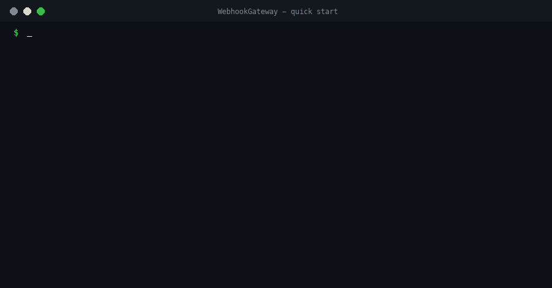

# WebhookGateway

**Send webhooks to your customers without building the plumbing.** Your application sends one event to one API. WebhookGateway delivers it to every subscribed endpoint, signed, retried with backoff, rate limited, and with a record of what failed. Open source (Apache-2.0), runs with one `docker compose up`, needs nothing but Docker.

> **Status: alpha.** The whole pipeline works and is tested end to end, including real HTTP delivery with signature verification. It has not been run in production yet. Read [what is and is not there](#status-and-limits) before relying on it.



*The whole quick start in 25 seconds, condensed from a real run of `docker compose up -d` and `./scripts/quickstart.sh` (keys shortened).*

## Contents

[Quick start](#quick-start) · [Use it from your app](#use-it-from-your-app) · [Sending events (API)](#sending-events-api) · [Receiving webhooks](#receiving-webhooks) · [Sample code](#sample-code) · [Operating it](#operating-it) · [Develop and extend](#develop-and-extend) · [Troubleshooting](#troubleshooting) · [Status and limits](#status-and-limits) · [Docs](#documentation)

## How it works

```
Your app ──POST /v1/events──▶ Ingest ──▶ queue ──▶ Fan-out ──▶ queue ──▶ Dispatcher ──signed POST──▶ your customers' endpoints
                                                       │                       │
                                                  event archive         failures + retries
                                                  (all in PostgreSQL by default; AWS backend optional)
```

| Service | What it does | Port |
|---|---|---|
| **Ingest** | The API you send events to. Checks the API key, rate limits, validates, stores the event, answers `202`. | 8080 |
| **Fan-out** | Finds which endpoints subscribed to the event type and creates one delivery per endpoint. | – |
| **Dispatcher** | Sends each delivery as a signed HTTP POST, retries failures, records what failed. | – |
| **ControlPlane** | The operator API: create customers (tenants), API keys, endpoints and subscriptions. | 8081 |
| **PostgreSQL** | Configuration, queues, delivery state, archive. The only stateful part. | internal |
| **Demo receiver** | A sample endpoint that verifies signatures and shows what arrived. Remove it for real use. | 9000 |

Features: API-key auth · per-customer rate limits and payload limits · idempotency keys · [Standard Webhooks](https://www.standardwebhooks.com/)-style HMAC signatures · retries over 24 hours to 7 days depending on plan · SSRF protection · multi-tenant plans kept as data · structured JSON logs with a `component` on every line · endpoint secrets encrypted at rest.

## Quick start

You need **Docker** (with Compose v2). Nothing else.

```bash
git clone https://github.com/twobudgies/WebhookGateway.git
cd WebhookGateway
docker compose up            # first start builds the images: a few minutes
```

When the logs settle, in a second terminal:

```bash
./scripts/quickstart.sh      # on Windows use WSL or Git Bash, or follow "Use it from your app" below
```

The script creates a customer, an API key and an endpoint, sends an event, and prints it arriving at the demo receiver with `"signature":"valid"`. Open <http://localhost:9000> to see the receiver's page.

### Try the APIs in your browser (Swagger)

Both APIs publish an interactive page where you can read every call and run it with **Try it out**, no tools needed:

| API | Swagger page | OpenAPI definition (for code generators, Postman, Insomnia) | Authorize with |
|---|---|---|---|
| **Events API** (your apps send events here) | <http://localhost:8080/docs> | <http://localhost:8080/openapi/v1.json> | a customer API key `wgk_live_...` |
| **Operator API** (create customers, keys, endpoints) | <http://localhost:8081/docs> | <http://localhost:8081/openapi/v1.json> | the admin key (see below) |

1. Open <http://localhost:8081/docs>, click **Authorize**, paste the admin key, then run **Create a customer**, **Create an API key** and **Register an endpoint** (the endpoint URL `http://receiver:8080/webhook` is the demo receiver).
2. Open <http://localhost:8080/docs>, click **Authorize**, paste the customer API key from step 1, open **Send an event**, click **Try it out** and **Execute**. You get `202` and an `eventId`.
3. Open <http://localhost:9000> to see the event arrive.

Your admin key is printed by the `init` container on first start: `docker compose logs init`, or any time with `docker compose exec controlplane sh -c '. /secrets/env; echo $ControlPlane__AdminKey'`.
Import the OpenAPI URL into Postman or Insomnia to get every call as a ready request, or generate a client in your language with [OpenAPI Generator](https://openapi-generator.tech/). Hide the pages with `WG_API_DOCS=false`.

That is the whole product running on your machine. Stop it with `Ctrl+C` (or `docker compose down`; add `-v` to delete all data).

## Use it from your app

There are two roles. You, the **operator**, set up customers with the admin key. Your **application** only needs an API key and the Ingest URL.

**1. Find your admin key.** It is generated on first start and printed by the `init` container; read it again any time:

```bash
docker compose exec controlplane sh -c '. /secrets/env; echo $ControlPlane__AdminKey'
export ADMIN_KEY=wgadmin_...
```

**2. Create a customer (tenant)** on a plan (`basic`, `advanced`, `premium`; the plans differ in rate, quota, endpoint count and retry window, see [`docs/tenancy-and-limits.md`](docs/tenancy-and-limits.md)):

```bash
curl -s -H "X-Admin-Key: $ADMIN_KEY" -H 'content-type: application/json' \
  -d '{"name":"Acme","plan":"basic"}' http://localhost:8081/admin/v1/tenants
# {"id":"01a1...","name":"Acme","status":"active","plan":"basic",...}
```

**3. Create an API key** for that customer. **It is shown once**; store it:

```bash
curl -s -X POST -H "X-Admin-Key: $ADMIN_KEY" http://localhost:8081/admin/v1/tenants/<tenantId>/api-keys
# {"id":"...","prefix":"wgk_live_xxx","key":"wgk_live_...","note":"Store this key now..."}
```

**4. Register an endpoint** (the URL that should receive webhooks) and the event types it wants (`*` = all). The **signing secret is shown once**; the receiver needs it to verify signatures:

```bash
curl -s -H "X-Admin-Key: $ADMIN_KEY" -H 'content-type: application/json' \
  -d '{"url":"https://example.com/webhooks","eventTypes":["order.created","invoice.paid"]}' \
  http://localhost:8081/admin/v1/tenants/<tenantId>/endpoints
# {"id":"...","url":"...","secret":"whsec_...","note":"Store the signing secret now..."}
```

**5. Send an event** from your application with the customer's API key:

```bash
curl -s -X POST http://localhost:8080/v1/events \
  -H "Authorization: Bearer $API_KEY" -H "Content-Type: application/json" \
  -H "Idempotency-Key: order-42-created" \
  -d '{"type":"order.created","data":{"orderId":42,"amount":1999}}'
# {"eventId":"evt_..."}   <- HTTP 202: accepted, delivery happens asynchronously
```

Prefer clicking? Use the [Swagger pages](#try-the-apis-in-your-browser-swagger), or open [`samples/api.http`](samples/api.http) in VS Code (extension "REST Client") or any JetBrains IDE: every call above, in order, with the values passed along automatically.

**6. Receive it** at your endpoint and verify the signature, see [Receiving webhooks](#receiving-webhooks). More operator calls (list, disable, change subscriptions, revoke keys, suspend a customer): [`docs/admin-api.md`](docs/admin-api.md).

## Sending events (API)

> Interactive version of this section: <http://localhost:8080/docs> (Swagger, while the stack is running).

`POST /v1/events` · header `Authorization: Bearer <api key>` · `Content-Type: application/json`

| Field | | |
|---|---|---|
| `type` | required | 1 to 128 characters of letters, digits, `.` `_` `:` `-`, e.g. `order.created` |
| `data` | required | any JSON **object** (the payload your customers receive) |
| `occurredAt` | optional | ISO-8601 time the event happened; defaults to the time it was received |
| header `Idempotency-Key` | recommended | up to 128 characters. Repeating a key within the plan's window (1 h basic, 24 h others) returns the **original** `eventId` and does not create a second event. Use one key per logical event and **reuse it when you retry**. |

Success: **`202`** `{"eventId":"evt_..."}`. `202` means *accepted and durably stored*, not *delivered*.

| Status | `error.code` | Meaning | What to do |
|---|---|---|---|
| 400 | `invalid_request` | bad JSON, missing/invalid field | fix the request |
| 401 | `unauthorized` | missing or wrong API key | check the key |
| 403 | `tenant_suspended` | the customer is suspended | contact the operator |
| 413 | `payload_too_large` | body over 256 KB | send less data |
| 429 | `rate_limited` / `quota_exceeded` | plan rate or monthly quota exceeded | wait `Retry-After` seconds, retry with the **same** idempotency key |
| 503 | `unavailable` | the event could not be stored | retry with backoff and the **same** idempotency key |

Errors look like `{"error":{"code":"...","message":"..."}}`. Rate limit headers: `RateLimit-Limit`, `RateLimit-Remaining`, and on `429` `Retry-After` and `RateLimit-Reset`.

## Receiving webhooks

WebhookGateway sends your customer's endpoint a `POST` with a JSON body and three headers.

```http
POST /webhooks HTTP/1.1
Content-Type: application/json
webhook-id: dlv_01a1...                 # unique per delivery; the same on every retry: use it to deduplicate
webhook-timestamp: 1761072800           # unix seconds
webhook-signature: v1,K5oZfzN95Z9UVu1EsfQmfVNd9...   # "v1,<base64>"; several space-separated while a secret is rotated

{"id":"evt_01a1...","type":"order.created","occurredAt":"2026-10-21T18:31:40Z","data":{"orderId":42,"amount":1999}}
```

**Always verify the signature** with the endpoint's `whsec_...` secret:

1. Take the **raw** request body (not re-serialized JSON).
2. Compute `base64( HMAC-SHA256( base64decode(secret without "whsec_"), "{webhook-id}.{webhook-timestamp}.{body}" ) )`.
3. Compare in constant time with each `v1,` signature in the header; accept if one matches.
4. Reject if `webhook-timestamp` is more than ~5 minutes from now (stops replays).

Ready-made, tested code for this in six languages is in [Sample code](#sample-code).

**Reply `2xx` within 10 seconds** to acknowledge. Do the real work after replying (put it on your own queue). Any other answer, or a timeout, is retried:

| Plan | Retry window | Waits between attempts (with jitter) |
|---|---|---|
| basic | about 24 hours | 30 s, 2 m, 10 m, 30 m, 1 h, 4 h, 8 h, 10 h |
| advanced | about 3 days | the same, then 2 more daily retries |
| premium | about 7 days | the same, then 6 more daily retries |

A `Retry-After` header on a `429/503` answer is honored (up to 1 hour). `410 Gone` and other `4xx` answers (except `408` and `429`) are treated as permanent failures and not retried. Redirects are not followed. Deliveries are **at least once**: your endpoint can get the same `webhook-id` twice, so make handling idempotent.

## Sample code

In [`samples/`](samples/): **send an event** and **verify a webhook** in each language. Standard library only, no packages to install. Each one retries `429`/`503` with the same idempotency key.

| Language | Send an event | Verify a webhook | Run |
|---|---|---|---|
| curl | [`curl/send-event.sh`](samples/curl/send-event.sh) | n/a | `bash samples/curl/send-event.sh` |
| Python 3 | [`python/send_event.py`](samples/python/send_event.py) | [`python/verify_webhook.py`](samples/python/verify_webhook.py) | `python3 samples/python/send_event.py` |
| C# (.NET 10) | [`csharp/send-event.cs`](samples/csharp/send-event.cs) | [`csharp/verify-webhook.cs`](samples/csharp/verify-webhook.cs) | `dotnet run samples/csharp/send-event.cs` |
| Java 11+ | [`java/SendEvent.java`](samples/java/SendEvent.java) | [`java/VerifyWebhook.java`](samples/java/VerifyWebhook.java) | `java samples/java/SendEvent.java` |
| Ruby | [`ruby/send_event.rb`](samples/ruby/send_event.rb) | [`ruby/verify_webhook.rb`](samples/ruby/verify_webhook.rb) | `ruby samples/ruby/send_event.rb` |
| Go | [`go/send_event.go`](samples/go/send_event.go) | [`go/verify_webhook.go`](samples/go/verify_webhook.go) | `go run samples/go/send_event.go` |

Set `WEBHOOKGATEWAY_API_KEY` (and `WEBHOOKGATEWAY_URL` if not `http://localhost:8080`) before running a send sample. `samples/test.sh` checks every sample against a known-good signature and, with a running stack, against the real API. Node.js and PHP samples are welcome as contributions.

## Operating it

- **Production checklist, TLS, backups, upgrades, sizing, security hardening:** [`docs/selfhost.md`](docs/selfhost.md). Read it before exposing the stack to the internet.
- **Every setting:** [`docs/configuration.md`](docs/configuration.md); the common ones can go in a `.env` file ([`.env.example`](.env.example)).
- **Logs:** one JSON line per event on stdout, always with `component`, `level`, `category`, `message` plus ids such as `tenantId`, `deliveryId`; payloads and secrets are never logged. `docker compose logs -f dispatcher`.
- **Back up** the `pgdata` volume **and** the `secrets` volume (the encryption key for endpoint secrets lives there; without it saved endpoints cannot be decrypted).

## Develop and extend

You need the **.NET 10 SDK** and **Docker**.

```bash
git clone https://github.com/twobudgies/WebhookGateway.git && cd WebhookGateway
./scripts/dev-up.sh     # PostgreSQL, Valkey and an AWS emulator for tests; applies the migrations
make verify             # format check, build (warnings are errors) and all tests
make images             # build the container images
```

| Path | What |
|---|---|
| `src/Ingest`, `src/FanOut`, `src/Dispatcher`, `src/ControlPlane` | the four services |
| `src/Abstractions` | **the ports**: small interfaces such as `IEventPublisher`, `IDeliverySource`, `IDeliveryStateStore`, `IArchive` that every storage backend implements |
| `src/ApiDocs` | OpenAPI + Swagger UI shared by the two APIs |
| `src/Postgres` | the default backend (queues, state, archive on PostgreSQL) and the config database stores |
| `src/Aws` | optional AWS backend: SQS, DynamoDB, S3, KMS |
| `src/Valkey` | optional shared rate limiting |
| `db/migrations` | the schema, plain SQL, applied by `src/Migrator` |
| `samples/`, `docs/`, `tests/` | sample code, documentation, unit and integration tests |

**Use it with AWS, or add your own backend.** The services never touch a database or queue directly; they use the interfaces in `src/Abstractions`, and `Backend__Mode` chooses the implementation: `Postgres` (default in Compose), `Aws` (SQS + DynamoDB + S3 + KMS, see `docs/configuration.md`) or `InMemory` (tests). To plug in another system (RabbitMQ, Kafka, Redis, GCS...), implement the ports in a new project and register them like `src/Postgres/Backend/PostgresBackendExtensions.cs` does. [`CONTRIBUTING.md`](CONTRIBUTING.md) has the working agreement; [`docs/flow-walkthrough.md`](docs/flow-walkthrough.md) follows one event through the code.

## Troubleshooting

| Problem | Check |
|---|---|
| `docker compose up` fails to build | Docker needs internet access and ~4 GB free disk; re-run, it resumes cached layers |
| Quick start says a service is unreachable | `docker compose ps`; look at `docker compose logs <service>`; default ports 8080/8081/9000 must be free (change with `WG_INGEST_PORT`, `WG_ADMIN_PORT`, `WG_RECEIVER_PORT`) |
| `401 unauthorized` on `/v1/events` | use the **customer** API key (`wgk_live_...`), not the admin key |
| `401` on `/admin/v1/...` | `X-Admin-Key` must be the key printed by the `init` container |
| Event accepted but nothing arrives | the endpoint must subscribe to that `type` (or `*`); `docker compose logs dispatcher fanout`; failed deliveries are retried on the schedule above |
| Endpoint URL rejected | `http://` and private addresses are allowed by default in Compose (`WG_ALLOW_INSECURE_HTTP`, `WG_ALLOW_PRIVATE_NETWORKS`); the cloud metadata address is always blocked |
| Start from scratch | `docker compose down -v` deletes the database **and** the generated secrets |

## Status and limits

Honest list, so you know what you are getting.

- **Works and is tested:** the full path (API key auth, limits, idempotency, routing, signing, delivery, retries, long retry waits, rollup counters, operator API), on PostgreSQL alone and on the AWS backend; 250+ automated tests; a CI job runs the Compose stack and the quick start.
- **Not there yet:** a customer-facing dashboard/portal, an events search UI, payload replay endpoint, endpoint secret rotation, per-endpoint rate limits and circuit breaker, Prometheus metrics, published container images, client SDK packages (the samples are plain code).
- **Throughput: not measured yet.** The target for the PostgreSQL backend is a few thousand events per second on one decent database server; real numbers will be published after the load tests ([`docs/load-testing.md`](docs/load-testing.md)). The AWS backend is the design path to tens of thousands per second.
- **Security:** API keys are stored hashed, signing secrets encrypted with a key from your environment, deliveries are signed, private addresses are blocked unless you allow them. Traffic is plain HTTP inside the Compose network and on the published ports: **put a TLS reverse proxy in front** (see `docs/selfhost.md`). The service sees event contents (it must, to deliver them); it is not end-to-end encrypted.
- **Alpha:** APIs and the database schema may still change; read the release notes when upgrading.

## Documentation

Start with [`docs/flow-walkthrough.md`](docs/flow-walkthrough.md).

| | |
|---|---|
| [`docs/selfhost.md`](docs/selfhost.md) | Running it for real |
| [`docs/admin-api.md`](docs/admin-api.md), [`docs/configuration.md`](docs/configuration.md) | Operator API, every setting |
| [`docs/architecture.md`](docs/architecture.md), [`docs/data-plane.md`](docs/data-plane.md), [`docs/database.md`](docs/database.md) | Design, queues and state, schema |
| [`docs/logging.md`](docs/logging.md), [`docs/decisions.md`](docs/decisions.md), [`docs/roadmap.md`](docs/roadmap.md) | Logging rules, why things are the way they are, what is next |

## Contributing, security, license

Contributions are welcome: [CONTRIBUTING.md](CONTRIBUTING.md). Report vulnerabilities privately as described in [SECURITY.md](SECURITY.md). Please follow the [Code of Conduct](CODE_OF_CONDUCT.md). Licensed under the [Apache License 2.0](LICENSE) ([NOTICE](NOTICE)).
