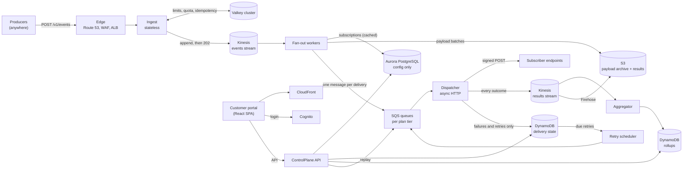
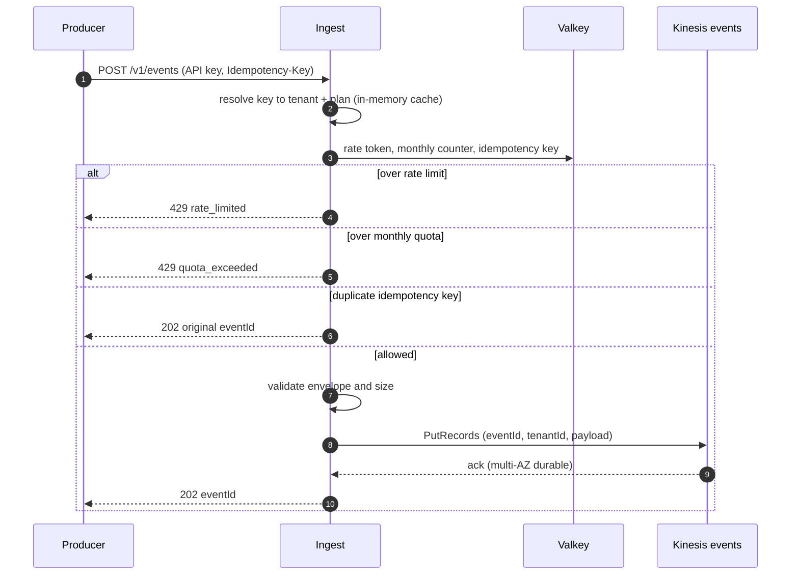
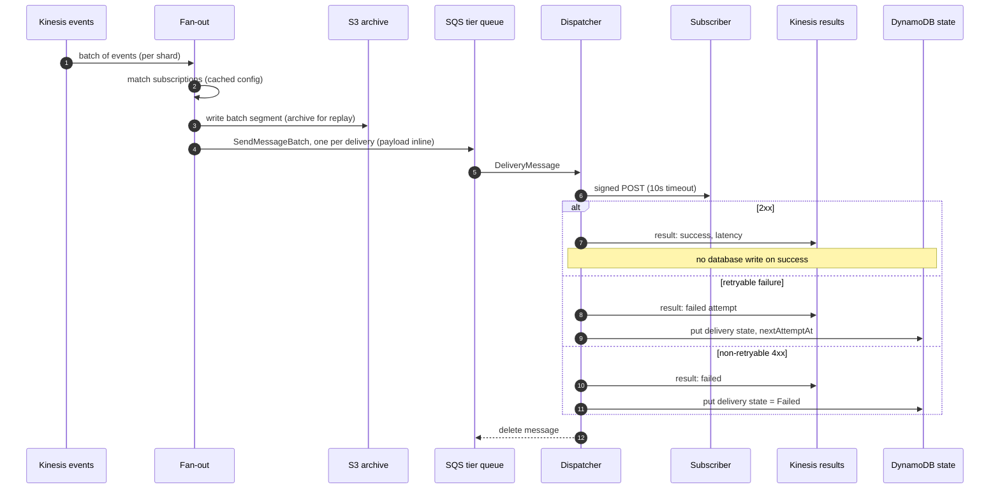
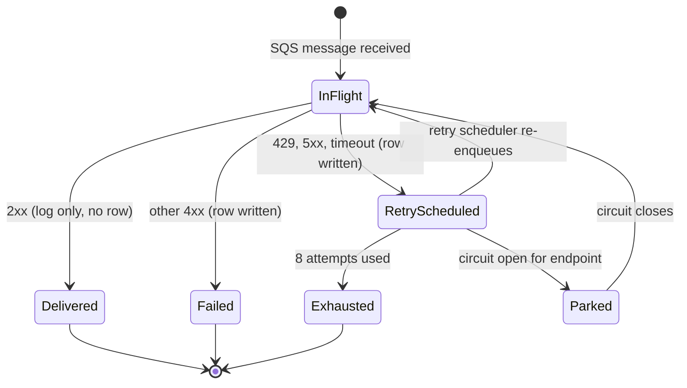
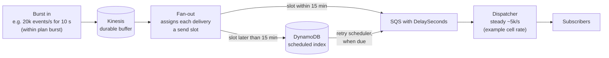
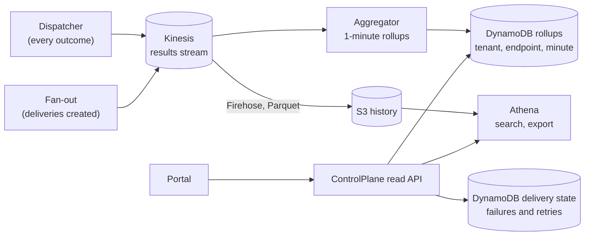
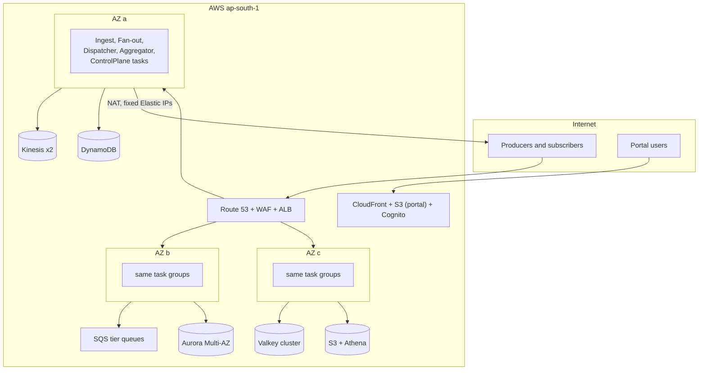

# Architecture

Status: **PROPOSAL v3, for owner review** (2026-10-20). Replaces v2 (which only scaled to ~2k events/s). Supersedes Baseline v1 once approved; later changes go through `decisions.md`.
Companion docs: `data-plane.md` (streams, queues, tables, S3 layout), `tenancy-and-limits.md` (plans, limits, quotas), `portal.md` (customer UI), `database.md` (PostgreSQL, in review), `contracts.md`.

Items marked **[DECIDE]** need an owner decision. They are collected in section 12.

## 1. Goal and scale targets

Webhook-as-a-service that competes with the established players: tenants register endpoints and subscribe to event types; producers send events; the platform delivers them reliably (signed, retried, audited), and tenants watch everything in a portal.

**One region cell must serve all of a region's customers.** Design targets for one cell (launch cell: `ap-south-1` Mumbai):

| Level | Accepted events/s | Deliveries/s (fan-out 3) | Meaning |
|---|---|---|---|
| Normal | 5,000 to 10,000 | 15,000 to 30,000 | Expected steady state when the product succeeds |
| **Design ceiling** | **30,000** | **90,000** | Sustained peak the architecture must handle without redesign |
| Today | a handful | a handful | Launch: tiny and cheap, but the same architecture |

Principles that follow from this:
1. **No relational database in the per-event path.** PostgreSQL holds configuration only. At 90,000 deliveries/s a single SQL writer is the wall (the v2 design stopped at ~2k events/s for this reason).
2. **Write state only for exceptions.** A successful delivery is recorded in an append-only log and in aggregate counters, not as a database row. Only failures and retries need per-delivery state.
3. **Durable log first.** An event is accepted once it is in a multi-AZ log; everything after that is asynchronous and replayable.
4. **Scale by adding workers or shards, never by rewriting.** Every stage scales horizontally and has a measured trigger (section 11).
5. **Accept fast, deliver steady.** Ingest accepts bursts up to the tenant's *plan*; delivery to subscribers then runs at a controlled, steady rate (per tenant and per endpoint), so a burst becomes a backlog that drains smoothly instead of a spike that hits the customer's servers or our workers (section 5.1).
6. **Cells.** If one cell is ever not enough, we add another cell; we do not stretch one past its design.

Launch scope: one AWS region (`ap-south-1`), three AZs; public API reachable worldwide. Out of scope for v1: event transformation, per-endpoint ordering, non-HTTP destinations, active-active multi-region.

## 2. Tech stack

- **.NET 10 (LTS)**, C# 14. Infrastructure as code: AWS CDK in C#.
- Compute: **ECS Fargate** (Ingest, Fan-out, Dispatcher, Aggregator, ControlPlane).
- Log: **Kinesis Data Streams** (on-demand) for accepted events and for delivery results.
- Work queues: **SQS** standard, one set per plan tier, with DLQs.
- State: **DynamoDB** (on-demand) for failed/retrying deliveries, idempotency fallback and portal rollups. **S3** (Parquet via Firehose) for the payload archive and result history, queryable with Athena.
- Config: **Aurora PostgreSQL** (Multi-AZ), low volume: tenants, plans, endpoints, subscriptions, keys.
- Hot shared state: **ElastiCache Valkey** cluster (rate limits, quotas, idempotency).
- Edge: **Route 53, WAF, ALB** (decision #2). Portal: **CloudFront + S3** static site, **Cognito** for login.
- Observability: CloudWatch, OpenTelemetry traces, per-tenant metrics via the rollup pipeline.

## 3. System overview

| Component | Repo / path | Role |
|---|---|---|
| Ingest | `src/Ingest` | Authenticates, enforces limits, validates, assigns `eventId`, appends to Kinesis, returns `202`. No database. |
| Fan-out | `src/FanOut` | Reads the events stream, resolves matching subscriptions from a cached config, writes payload batches to S3, enqueues one SQS message per delivery. |
| Dispatcher | `src/Dispatcher` | Consumes deliveries, signs, POSTs with async I/O, publishes every outcome, writes state only on failure. |
| Retry scheduler | `src/Dispatcher` (separate host) | Moves due retries from DynamoDB back to SQS; honors circuit breakers. |
| Aggregator | `src/Aggregator` | Reads the results stream and maintains per-tenant, per-endpoint rollups for the portal. |
| ControlPlane | `src/ControlPlane` | Management API (tenants, endpoints, keys) and the portal's read API. Separate from Ingest (revises D8). |
| Portal | repo `webhookgateway-portal` | Customer UI. See `portal.md`. |

## 4. Event ingest flow

- `202` means the event is durably in the log. Nothing else happens on the request path, so Ingest latency is dominated by one Kinesis write (target p99 under 100 ms).
- Ingest batches Kinesis writes per task (up to 500 records per call, 5 ms linger) to stay within shard limits.
- Rate-limit calls to Valkey are reduced by **token pre-reservation**: a task takes tokens in chunks (e.g. 20) per tenant and spends them locally.
- **Idempotency** keys live in Valkey with a TTL (default 24 h, per-plan). Only requests that send the header pay this cost. **[DECIDE]** TTL by plan; memory at 30,000 keyed events/s over 24 h is large, so Basic may get 1 h.

## 5. Fan-out and delivery flow

Key points:
- **Payload travels inline in the delivery message** (up to ~200 KB; larger payloads use an S3 pointer). SQS encrypts at rest with KMS. This reverses D4 (pointer-only): at 90,000 deliveries/s an extra read per delivery costs more than the bytes. **[DECIDE]** #5.
- **S3 archive** holds every event in large batched objects (thousands of events per object, not one PUT per event). It serves replay, audit and retention, not the delivery hot path.
- **Success path = one HTTP call + one log record.** Failure path adds DynamoDB writes. Assuming 2% failures, DynamoDB sees about 2% of delivery volume.

### Delivery lifecycle (only exceptions get a row)

Retry policy (unchanged): max 8 attempts over about 24 h; backoff ~30 s, 2 m, 10 m, 30 m, 1 h, 4 h, 8 h, 10 h with full jitter; `Retry-After` honored (capped). Delays up to 15 min via SQS delay; longer via the **retry scheduler** reading a DynamoDB due-time index (instead of one EventBridge schedule per retry, which hits quota under an outage). After exhaustion the item stays visible in the portal for replay.

### 5.1 Accept fast, deliver steady (pacing)

Two different limits, on purpose:

| | Accept (Ingest) | Deliver (to subscribers) |
|---|---|---|
| Limited by | Plan: events/s (token bucket with burst) + monthly quota | Plan: **steady delivery rate** per tenant, plus **per-endpoint rate** (tenant-configurable, to protect their server) |
| When exceeded | `429` to the producer | Nothing is rejected: the delivery waits in the backlog and is sent when its slot arrives |
| Purpose | Fair use, billing | Smooth load, protect subscribers and our workers |

How the slot is assigned (virtual scheduling, a leaky bucket):
- For each tenant (and each endpoint with a configured rate), Valkey holds `nextFreeSlot`. Fan-out reserves slots in chunks: `slot = max(now, nextFreeSlot)`, then `nextFreeSlot = slot + 1 / rate`.
- A delivery whose slot is `now` is enqueued immediately; one whose slot is later is enqueued with `DelaySeconds` (up to 15 min) or, if later still, written to the scheduled index in DynamoDB and released by the retry scheduler.
- Pacing is therefore enforced **before** work reaches the Dispatcher, so slow-draining tenants never block others on the same queue.

Bounds, so a backlog cannot grow forever:
- **Max backlog per plan**, in events and in age (for example Basic 1 h of delivery at its rate). Beyond it Ingest returns `429 backlog_full` for that tenant only. **[DECIDE]** #14.
- Backlog is visible: the portal shows pending count, oldest pending age and an estimated drain time per endpoint.
- The cell has a **global dispatch ceiling** set by Dispatcher capacity (autoscaled; queue age is the signal). The steady rate is a dial, not a constant: today it is small, and it rises with capacity up to the 90,000 deliveries/s design ceiling.

The delivery-start target in section 8 therefore applies to tenants **within their delivery rate**; during a burst, delivery time is backlog divided by rate, and the portal says so.

### Slow and failing consumers (isolation)

- **Async I/O** with thousands of in-flight requests per task: a slow endpoint costs a socket, not a thread.
- **Max concurrent connections per tenant (plan-based) and per endpoint.** A slow consumer is the real starvation risk: by Little's law, connections in use = deliveries/s x response time, so an endpoint answering in 10 s at 300 deliveries/s holds 3,000 connections for itself. Without a cap, a few slow tenants would take every connection from everyone else.
  - Each tenant has a **connection budget** (`maxConnections`) and each endpoint a smaller one (`maxConnectionsPerEndpoint`). The budget is global across Dispatcher tasks: a task leases permits for a tenant from Valkey (chunks, short lease renewed while in use, so a crashed task's permits expire on their own).
  - No permit: the message is **not** held by a worker. It goes back to the queue with a short delay (visibility change) and the worker moves on to the next tenant's work. The slow tenant's throughput self-limits to `connections / response time`; everyone else is unaffected.
  - **Inside every task**, work is scheduled fairly across tenants (per-tenant bounded in-memory queues, weighted round robin by plan), and a task never lets one tenant use more than a fixed share of its own connection pool. So the cap holds even if Valkey is briefly unavailable (the task falls back to its local per-tenant share).
  - A tenant's own slow endpoints compete for that tenant's budget only; they cannot reduce another tenant's budget.
- **Per-endpoint concurrency cap** (plan-based). Excess messages are re-queued with a short delay instead of blocking workers.
- **Circuit breaker per endpoint**, state in Valkey: after N consecutive failures the endpoint is `Degraded`, attempts slow down, then deliveries are **parked** (cheap backlog) rather than retried at full speed. This prevents a retry storm when a big subscriber is down.
- **One queue set per plan tier**: a Basic flood cannot starve Premium. Large tenants can later get a dedicated queue.
- **Slow = measured**, not guessed: the Aggregator tracks response-time percentiles, timeout rate and **connection-seconds consumed** (sum of response times) per endpoint (section 7). The portal shows slow consumers prominently, including which ones are eating the tenant's connection budget (`portal.md`).

## 6. Rate limits and quotas

Per tenant, enforced in Ingest before any write (this is the **accept** limit; the separate **delivery** pacing is section 5.1); full design in `tenancy-and-limits.md`. Basic 100, Advanced 500, Premium 1,000 events/s; a custom **Enterprise** plan is a plan row with overrides. A 30,000 events/s cell therefore means many tenants, not one. Monthly quotas are counted in Valkey and flushed to PostgreSQL once a minute.

## 7. Observability and the portal data path

The portal shows, per tenant and per endpoint: accepted/succeeded/failed counts, success rate, **latency p50/p95/p99**, timeout rate, **queue wait vs endpoint response time** (tells "our backlog" apart from "your slow server"), pending/retrying/parked counts, endpoint health, and quota usage. Failures come from the DynamoDB state table (detail, attempts, replay); aggregates come from rollups; deep history and CSV export come from Athena over S3.

**[DECIDE]** #8: successful events are not stored as searchable rows (cost). The portal can show every success *in aggregate* immediately, and per-event success lookup by `eventId` through Athena (latency of seconds to a minute). A real-time searchable success index (OpenSearch) is possible later as a paid add-on.

## 8. Deployment topology (launch cell)

- Dispatcher egress uses **NAT gateways with several fixed Elastic IPs** per AZ so tenants can allowlist us, and so a very busy single subscriber does not exhaust one IP's ports (about 55,000 connections per IP and destination).
- Environments `dev`, `staging`, `prod` in separate AWS accounts, same IaC.
- Targets: ingest availability **99.95%** monthly, `202` p99 under 100 ms, **delivery start p95 under 2 s** after accept for tenants within their delivery rate (section 5.1), RPO under 5 min for config, RTO 1 h.

## 9. Sizing: what each level needs

Rough capacity at fan-out 3, average event 2 KB, 2% failure rate. **Per-task throughput numbers are assumptions; the load test (work item L1) replaces them with measurements.**

| Resource | 5,000 events/s | 10,000 events/s | 30,000 events/s |
|---|---|---|---|
| Deliveries/s (outbound HTTP) | 15,000 | 30,000 | 90,000 |
| Ingest tasks (2 vCPU, ~1,000 rps each, +50%) | 8 | 15 | 45 |
| Kinesis events stream (~ MB/s in) | 10 | 20 | 60 |
| Fan-out tasks (~2,000 events/s each) | 3 | 5 | 15 |
| Dispatcher tasks (~1,500 deliveries/s each) | 10 | 20 | 60 |
| Valkey operations/s (2-3 per event, with pre-reservation less) | 15,000 | 30,000 | 90,000 (3 to 6 shards) |
| DynamoDB state writes/s (failure path) | ~1,000 | ~2,000 | ~6,000 |
| Aggregator rollup writes/s | ~1,000 | ~2,000 | ~3,000 |
| PostgreSQL | idle (config) | idle | idle |

Cost reality check: 30,000 events/s sustained is about **78 billion events a month**. Infrastructure cost is dominated by Kinesis/SQS request volume, outbound NAT data and S3 history, not by compute. The architecture avoids per-event database writes precisely to keep this cost proportional to revenue. A cost model per million events is a work item (L2) before we price Premium.

## 10. Going global later

"Available globally" means two things; we treat them separately:

| Need | Launch | Later |
|---|---|---|
| Producers worldwide can call the API | Yes, public endpoint | CloudFront / Global Accelerator in front |
| Data stays in India | Yes | Per-tenant `home_region`, regional cells |
| Region outage survival | Multi-AZ only | Second cell (e.g. `ap-south-2` or Singapore) with replicated config |
| Low latency near producers | No | More cells; edge routes by tenant home region |

Rules we keep from day one: a cell is self-contained; no region in code or data; globally unique prefixed ULIDs; `home_region` on every tenant; IaC parameterized by region; a small global tenant directory (API key to home region) added when the second cell exists.

## 11. Scale triggers (what we watch, what we do)

| Signal | Threshold | Action |
|---|---|---|
| Kinesis events stream iterator age | over 10 s | Add fan-out tasks; check shard count |
| Delivery queue age (any tier) | over 30 s | Add Dispatcher tasks; look for slow endpoints |
| Ingest p99 | over 150 ms | Add Ingest tasks; check Kinesis throttling |
| Valkey CPU | over 60% | Add shards |
| NAT port allocation errors | any | Add Elastic IPs / NAT gateways |
| Aggregator lag | over 60 s | Add aggregator tasks |
| Accepted events/s sustained | over 25,000 | Plan the next cell with the owner |

## 12. Decisions needed from the owner

| # | Decision | My recommendation |
|---|---|---|
| 1 | Monthly event caps per plan, and whether an Enterprise (custom) plan exists | You choose; see `tenancy-and-limits.md` |
| 2 | Edge: ALB vs API Gateway HTTP API | ALB + WAF |
| 3 | **Hybrid data layer**: PostgreSQL for config only; Kinesis + DynamoDB + S3 for the data plane (reopens your D10; supersedes D12 outbox) | Yes, required for 30k events/s |
| 4 | Separate `ControlPlane` service instead of hosting it in Ingest (revises D8) | Yes |
| 5 | Payload inline in SQS messages (reverses D4 pointer-only) | Yes, KMS-encrypted |
| 6 | One delivery queue set per plan tier | Yes |
| 7 | Endpoint secrets: envelope encryption in the database with KMS (vs one Secrets Manager secret per endpoint) | Envelope encryption + KMS |
| 8 | Success history: aggregate counts in real time, per-event success lookup via Athena (not a live index) | Yes; OpenSearch add-on later |
| 9 | Fan-out deliveries do not count against plan limits; cap endpoints per plan | Yes |
| 10 | Over-quota: hard stop (`429`) vs billable overage | Hard stop for Basic; overage later |
| 11 | Availability 99.95%, `202` p99 under 100 ms, delivery start p95 under 2 s, RTO 1 h | Accept for launch |
| 12 | Portal in its own repo `webhookgateway-portal` (React + TypeScript) | Yes; contracts via OpenAPI in this repo |
| 13 | Idempotency window per plan (1 h Basic, 24 h others) | Yes |
| 14 | Delivery pacing (section 5.1): per-tenant steady delivery rate by plan, per-endpoint rate configurable by the tenant, max backlog per plan (`429 backlog_full` beyond it). Numbers in `tenancy-and-limits.md` | Yes |
| 15 | Max concurrent connections per tenant and per endpoint, enforced globally with leased permits plus a fair share inside each task (section 5, "Slow and failing consumers"). Numbers in `tenancy-and-limits.md` | Yes |

Also required before code: a **load-test harness** (producers at up to 30,000 events/s, mock subscribers that are fast, slow and failing) so every number in section 9 becomes a measurement.

`database.md` stays **in review**. Its scope shrinks under this proposal (events, deliveries, attempts and outbox leave PostgreSQL); the proposed tables are in `data-plane.md` and `tenancy-and-limits.md`.
