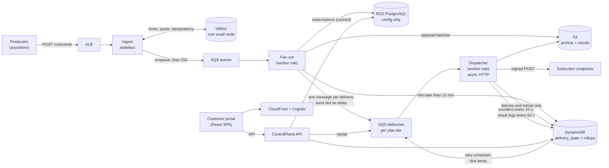
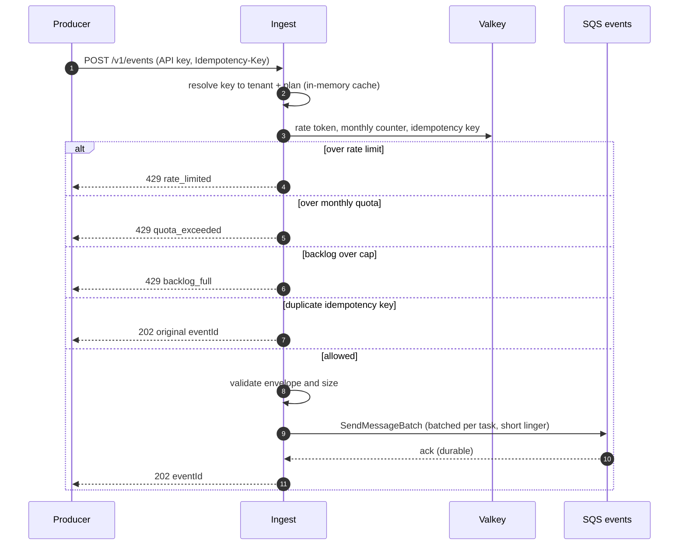
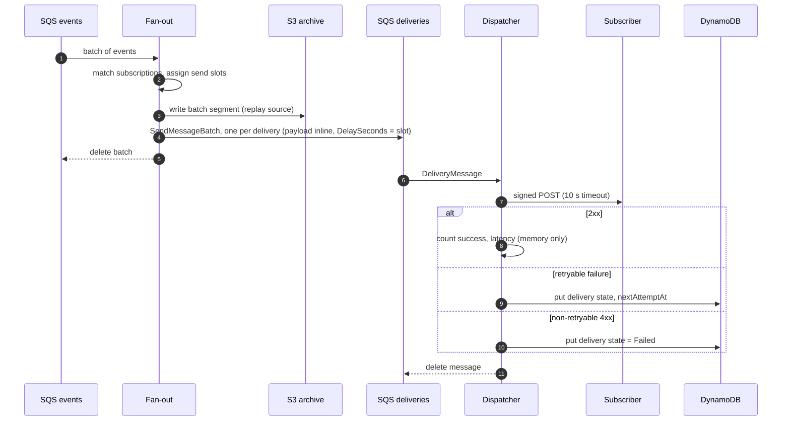
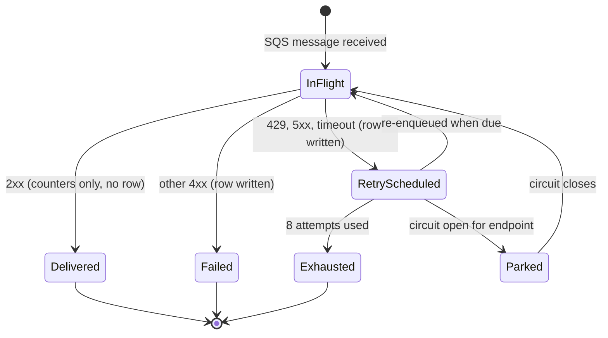
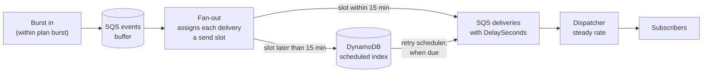
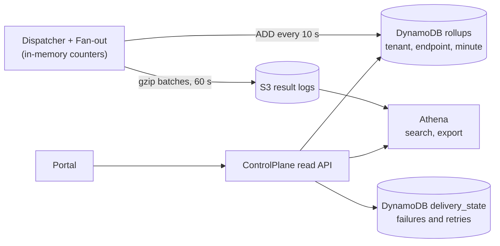
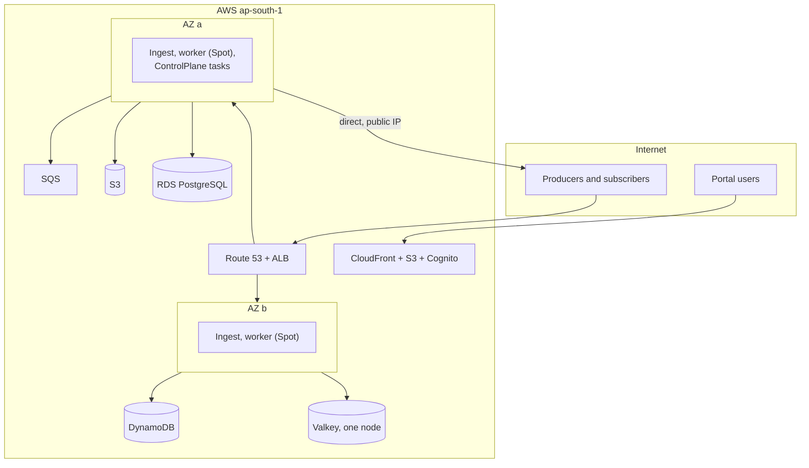

# Architecture

Status: **PROPOSAL v4, for owner review** (2026-10-20). Replaces v3 (Kinesis-based, too expensive for launch) and v2. Supersedes Baseline v1 once approved; later changes go through `decisions.md`.
Companion docs: `cost-model.md` (monthly bill and per-event cost), `data-plane.md` (queues, tables, S3 layout), `tenancy-and-limits.md` (plans and limits), `portal.md` (customer UI), `database.md` (PostgreSQL, in review), `contracts.md`.

Items marked **[DECIDE]** need an owner decision. They are collected in section 12.

## 1. Goal and staging

Webhook-as-a-service that competes with established players: tenants register endpoints and subscribe to event types; producers send events; the platform delivers them reliably (signed, retried, audited), and tenants watch everything in a portal.

**Two things are true at once, so the design has two stages:**

| | Stage 1: launch (this proposal's build target) | Stage 2: scale (designed for, built on trigger) |
|---|---|---|
| Traffic | A handful of customers, up to a few hundred events/s | 5,000 to 10,000 events/s normal, **30,000 events/s ceiling** in one region cell |
| Priority | **Lowest possible monthly bill**, pay-per-use wherever possible | Throughput and unit cost per million events |
| Event queue | **SQS** | SQS, or Kinesis if it becomes cheaper (section 10) |
| Everything else | Same components and same code | Same components, bigger and sharded |

The point of staging: **no rewrite between stages.** Each cost-saving shortcut sits behind an interface (`IEventQueue`, `IRateLimiter`, `IStateStore`) or is a deployment choice, and section 10 lists the exact swap and the trigger that justifies it.

Launch scope: one AWS region (`ap-south-1`); public API reachable worldwide. Out of scope for v1: event transformation, per-endpoint ordering, non-HTTP destinations, active-active multi-region.

## 2. Principles

1. **Pay per use.** Prefer services with no hourly floor (SQS, DynamoDB on-demand, S3, Lambda-like billing). Every always-on component must justify its monthly floor.
2. **No relational database in the per-event path.** PostgreSQL holds configuration only.
3. **Write state only for exceptions.** A successful delivery is a counter increment and a batched log line, not a database row. Only failures and retries get a row.
4. **Durable queue first.** An event is accepted once it is in SQS (multi-AZ durable); everything after is asynchronous.
5. **Accept fast, deliver steady.** Ingest accepts bursts up to the tenant's plan; delivery runs at a controlled rate per tenant and per endpoint (section 6.1).
6. **Slow consumers cannot starve others**: per-tenant and per-endpoint connection budgets (section 6.2).
7. **One container image, several roles.** Fan-out, Dispatcher and retry scheduler are separate code but run as one `worker` deployment at launch and are split when load needs it.
8. **Cells.** If one region cell is ever not enough, add another; do not stretch one past its design.

## 3. Tech stack

- **.NET 10 (LTS)**, C# 14. Infrastructure as code: AWS CDK in C#.
- Compute: **ECS Fargate**, small tasks; **Fargate Spot** for the worker role (safe: SQS is at-least-once).
- Queues: **SQS standard** (`events`, `deliveries-{tier}`, DLQs).
- State: **DynamoDB on-demand** (failed/retrying deliveries, rollups, scheduled deliveries). **S3** (payload archive, result logs, portal site).
- Config: **RDS PostgreSQL** (db.t4g class), low volume. Moves to Aurora when load or availability needs it (same engine).
- Shared hot state: one small **ElastiCache Valkey** node (rate buckets, counters, idempotency, permits). If it is down, services fall back to local limits (section 5).
- Edge: **one ALB** (ingest + control plane by host/path), ACM certificates, Route 53. **No WAF at launch** (section 8).
- Portal: **CloudFront + S3**, **Cognito** for login.
- Observability: CloudWatch (low log volume, sampled), OpenTelemetry traces.

## 4. System overview (Stage 1)

| Component | Path | Role |
|---|---|---|
| Ingest | `src/Ingest` | Authenticates, enforces limits, validates, assigns `eventId`, enqueues to SQS, returns `202`. No database. |
| Fan-out | `src/FanOut` | Reads `events`, matches subscriptions (cached config), writes payload batch to S3, enqueues one message per delivery with its pacing delay. |
| Dispatcher | `src/Dispatcher` | Consumes deliveries, signs, POSTs (async I/O), records state only on failure, aggregates counters and result logs in memory and flushes them in batches. Hosts the retry scheduler. |
| ControlPlane | `src/ControlPlane` | Management API and the portal read API. Not on the event path. |
| Portal | repo `webhookgateway-portal` | Customer UI (`portal.md`). |

There is no separate Aggregator service in Stage 1: Dispatcher and Fan-out keep per-tenant, per-endpoint counters and latency histograms in memory and write them to DynamoDB with atomic `ADD` every 10 s. Write volume depends on active endpoints, not on event rate.

## 5. Event ingest flow

- `202` means the event is durably in SQS. Ingest does one SQS send per batch of up to 10 events (5 ms linger), which keeps SQS requests at about 0.1 per event.
- **If Valkey is down:** Ingest uses a local limiter at `plan rate / running tasks`, keeps accepting, and alarms. Quota is checked against the last flushed PostgreSQL value plus the local count.
- **Idempotency** keys live in Valkey with a per-plan TTL (1 h Basic, 24 h others). Only requests that send the header use it.

## 6. Fan-out and delivery flow

- **Payload travels inline** in the delivery message (up to about 200 KB; larger ones use an S3 pointer). SQS encrypts at rest with KMS. This reverses D4 (pointer-only) because an extra read per delivery costs more than the bytes.
- **S3 archive** holds events in large batched objects (thousands per PUT). It is the replay and retention source, replacing the replay a Kinesis log would have given.
- **Success path = one HTTP call plus in-memory counters.** DynamoDB sees only about 2% of deliveries (failures) plus periodic counter flushes.

### Delivery lifecycle (only exceptions get a row)

Retry policy: max 8 attempts over about 24 h; backoff ~30 s, 2 m, 10 m, 30 m, 1 h, 4 h, 8 h, 10 h with full jitter; `Retry-After` honored (capped). Delays up to 15 min use SQS `DelaySeconds`; longer ones use a DynamoDB due-time index read by the **retry scheduler** (no per-retry EventBridge schedule, which would hit quotas in an outage). After exhaustion the item stays visible in the portal for replay.

### 6.1 Accept fast, deliver steady (pacing)

| | Accept (Ingest) | Deliver (to subscribers) |
|---|---|---|
| Limited by | Plan: events/s (token bucket with burst) + monthly quota | Plan: steady **delivery rate** per tenant, plus **per-endpoint rate** (tenant-configurable) |
| When exceeded | `429` to the producer | Nothing is rejected: the delivery waits in the backlog until its slot |
| Purpose | Fair use, billing | Smooth load, protect subscribers and our workers |

- For each tenant (and each endpoint with a rate), Valkey holds `nextFreeSlot`. Fan-out reserves slots in chunks: `slot = max(now, nextFreeSlot)`, then `nextFreeSlot = slot + 1/rate`. A delivery with a later slot is enqueued with `DelaySeconds`, or parked in DynamoDB if more than 15 minutes away.
- **Max backlog per plan** (events and age); beyond it Ingest returns `429 backlog_full` for that tenant only. The backlog is visible in the portal with an estimated drain time.
- The delivery-start target applies to tenants **within their delivery rate**; during a burst, delivery time is backlog divided by rate.

### 6.2 Slow and failing consumers (isolation)

- **Async I/O** with thousands of in-flight requests per task: a slow endpoint costs a socket, not a thread.
- **Max concurrent connections per tenant and per endpoint** (plan-based). By Little's law, connections in use = deliveries/s x response time, so an endpoint answering in 10 s at 300 deliveries/s holds 3,000 connections. The tenant has a global **connection budget**: a task leases permits per tenant from Valkey (chunks, short lease renewed while used, so a crashed task's permits expire). With no permit the message goes back to the queue with a short delay and the worker takes other work. The slow tenant's throughput self-limits to `connections / response time`; others are unaffected.
- **Inside every task**, work is scheduled fairly across tenants (per-tenant bounded queues, weighted round robin by plan) and no tenant may exceed a fixed share of the task's pool. This also holds when Valkey is unavailable (local per-tenant share).
- **Circuit breaker per endpoint** (state in Valkey): after N consecutive failures the endpoint is `Degraded`, attempts slow down, then deliveries are **parked** instead of retried at full speed, avoiding retry storms.
- **One queue set per plan tier**, so a Basic flood cannot starve Premium.
- **Slow = measured**: response-time percentiles, timeout rate and connection-seconds consumed per endpoint feed the portal (section 7).

## 7. Observability and the portal data path

The portal shows per tenant and per endpoint: accepted/delivered/failed, success rate, latency p50/p95/p99, timeout rate, queue wait vs endpoint response time, pending/retrying/parked, health, connection use and quota. See `portal.md`.

**[DECIDE]** #8: successful events are not stored as searchable rows (cost). Successes are shown in aggregate immediately; per-event success lookup by `eventId` goes through Athena (seconds to a minute). A live searchable index (OpenSearch) is a later paid add-on.

## 8. Deployment topology and cost-first choices (Stage 1)

| Choice | Saves | Cost of the choice | Revisit when |
|---|---|---|---|
| **No NAT gateway.** Tasks run in public subnets with a public IP; security groups allow inbound only from the ALB. Dispatcher calls subscribers directly. | ~$33 per NAT per month plus $0.045 per GB, which becomes the second-largest bill at scale | Outbound IPs are not fixed, so tenants cannot allowlist us | A tenant needs fixed IPs: offer it as an Enterprise option with NAT + Elastic IPs |
| **No Kinesis.** SQS for events. | Kinesis hourly and per-GB floors | No replayable log; S3 archive is the replay source | Section 10 |
| **No WAF** on ingest at launch | $5 + $1 per rule + **$0.60 per million requests** | Less protection from abusive floods; API key check, per-tenant limits and AWS Shield Standard (free) remain | Real abuse, or a customer requires it |
| **RDS PostgreSQL (db.t4g)** instead of Aurora | Aurora's higher floor (~$100+ for two instances) | Fewer scaling options | Config load or availability needs it |
| **One small Valkey node**, no replica | Replica and cluster floor | Brief loss of limit precision if it fails (local fallback) | Production incident, or scale |
| **Fargate Spot** for the worker role | ~70% of worker compute | Interruptions; SQS redelivers | Never for Ingest or ControlPlane |
| **Tiny tasks** (0.25 to 0.5 vCPU), minimum 2 for Ingest (two AZs) | Compute | Autoscale up on CPU and queue age | Per load test |
| **One ALB** for ingest and control plane | A second ALB | Shared | Scale |
| **Staging is ephemeral**, dev runs locally (Docker, LocalStack, Testcontainers) | Two always-on environments | Staging is created for release testing and torn down | Customers need a persistent staging |

Targets for Stage 1: ingest availability 99.9% (two AZs), `202` p99 under 150 ms, delivery start p95 under 5 s within plan rate, RPO 5 min for config (RDS backups), RTO 1 h. These tighten in Stage 2.

## 9. Cost summary

Detail and assumptions in `cost-model.md`. All numbers are estimates from public list prices as I remember them, not yet verified for ap-south-1.

| | Monthly (USD) |
|---|---|
| **Stage 1 fixed floor** (everything running, near-zero traffic) | **~$200 to 250** |
| Variable cost per million events (fan-out 3, 2.5 KB payload, 2% failures) | **~$1.6** (about half is outbound data, a third is SQS) |
| 100M events/month (about 40 events/s average) | ~$390 |
| 1B events/month (about 400 events/s average) | ~$1.85k |
| 30k events/s sustained (79B events/month), for reference | ~$130k |

## 10. Stage 2: the scale path (30,000 events/s ceiling), built on trigger

SQS standard has no throughput limit, so the same design reaches 30,000 events/s. What changes is sizing and a few swaps. Each has an owner-visible trigger.

| Swap | Trigger | Notes |
|---|---|---|
| Add task replicas, split `worker` into FanOut / Dispatcher / retry scheduler deployments | CPU over 60% or queue age over target | Pure configuration |
| **Shard queues** (N `deliveries-{tier}` queues, hash by endpoint) | A queue approaches the 120,000 in-flight message limit or one queue's throughput | Needed well before 30k events/s |
| Valkey single node to a cluster with replicas | Valkey CPU over 60% or an incident | Same client, same keys |
| RDS to Aurora PostgreSQL | Config load or availability | Same engine |
| Add NAT + fixed Elastic IPs for tenants who need allowlisting | First such customer (Enterprise) | Per-tenant dedicated egress group |
| Aggregator as its own service | Counter flush load on workers | Reads result logs instead of in-memory counters |
| Replace SQS `events` with **Kinesis** | Only if it measures cheaper at sustained volume (provisioned shards beat SQS per-request cost at very high steady rates, see `cost-model.md`) | Behind `IEventQueue`; adds replay |
| WAF on ingest | Abuse, compliance, or a customer asks | Scope rules to cut per-request charges |
| Second cell | Sustained over 25,000 events/s, or a latency/residency requirement | Section 11 |

Rough Stage 2 sizing (assumptions to be replaced by the load test): 5,000 events/s needs about 8 Ingest, 10 Dispatcher tasks; 30,000 events/s about 45 Ingest, 15 Fan-out, 60 Dispatcher tasks, a 3 to 6 shard Valkey cluster, and several sharded delivery queues. At that point the bill is dominated by outbound data and SQS requests (`cost-model.md`), not by compute.

## 11. Going global later

| Need | Launch | Later |
|---|---|---|
| Producers worldwide can call the API | Yes, public endpoint | CloudFront or Global Accelerator in front |
| Data stays in India | Yes | Per-tenant `home_region`, regional cells |
| Region outage survival | Multi-AZ only | Second cell with replicated config |
| Low latency near producers | No | More cells, edge routing by home region |

Rules kept from day one: a cell is self-contained; no region in code or data; globally unique prefixed ULIDs; `home_region` on every tenant; IaC parameterized by region.

## 12. Decisions needed from the owner

| # | Decision | My recommendation |
|---|---|---|
| 1 | Monthly caps per plan; is there an Enterprise plan? | You choose; see `tenancy-and-limits.md` |
| 2 | Edge: one ALB, no WAF at launch | Yes (API Gateway costs $1 per million requests, ALB wins above ~20M/month) |
| 3 | **SQS only at launch; Kinesis not used.** Hybrid data layer: PostgreSQL for config, SQS + DynamoDB + S3 for the data plane (reopens D10; supersedes D12 outbox) | Yes |
| 4 | Separate `ControlPlane` service (revises D8), co-deployed as a tiny task | Yes |
| 5 | Payload inline in SQS messages (reverses D4) | Yes, KMS-encrypted |
| 6 | One delivery queue set per plan tier | Yes |
| 7 | Endpoint secrets: envelope encryption in the database with KMS, not one Secrets Manager secret per endpoint ($0.40 each per month) | Yes |
| 8 | Success history: aggregate in real time, per-event success lookup via Athena | Yes |
| 9 | Fan-out deliveries do not count against plan limits; cap endpoints per plan | Yes |
| 10 | Over-quota: hard stop (`429`) vs billable overage | Hard stop first |
| 11 | Stage 1 targets: 99.9% availability, `202` p99 under 150 ms, delivery start p95 under 5 s | Accept for launch |
| 12 | Portal in its own repo `webhookgateway-portal` (React + TypeScript) | Yes |
| 13 | Idempotency window per plan (1 h Basic, 24 h others) | Yes |
| 14 | Delivery pacing, per-tenant delivery rate, per-endpoint rate, max backlog | Yes |
| 15 | Max concurrent connections per tenant and per endpoint | Yes |
| 16 | **No NAT at launch**: tasks in public subnets; fixed outbound IPs only as an Enterprise option | Yes |
| 17 | RDS PostgreSQL (not Aurora) and a single small Valkey node at launch | Yes |
| 18 | Ephemeral staging, local dev | Yes |

Also required before code: a **load-test harness** (producers at up to 30,000 events/s against mock subscribers that are fast, slow and failing) so every number in section 10 becomes a measurement, and the **cost model** work item (verify prices for ap-south-1).

`database.md` stays **in review**; its scope shrinks under this proposal (events, deliveries, attempts and outbox leave PostgreSQL); see `data-plane.md`.
