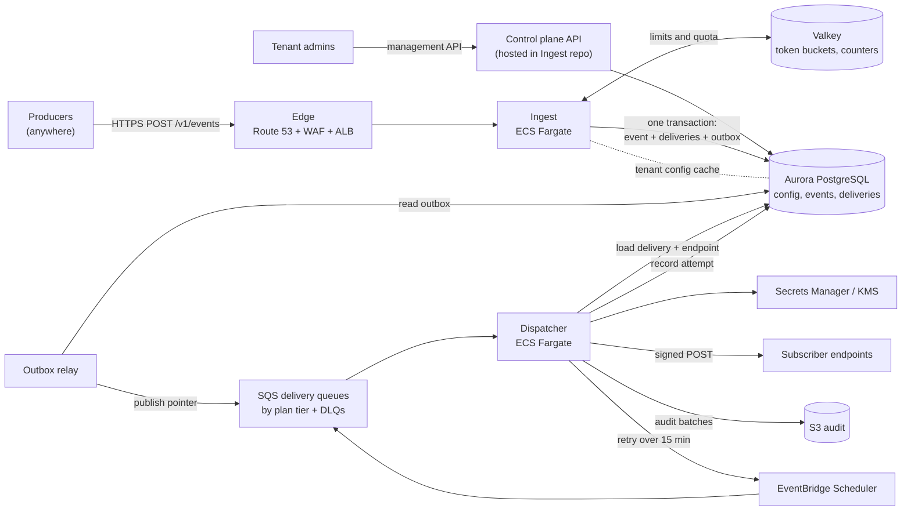
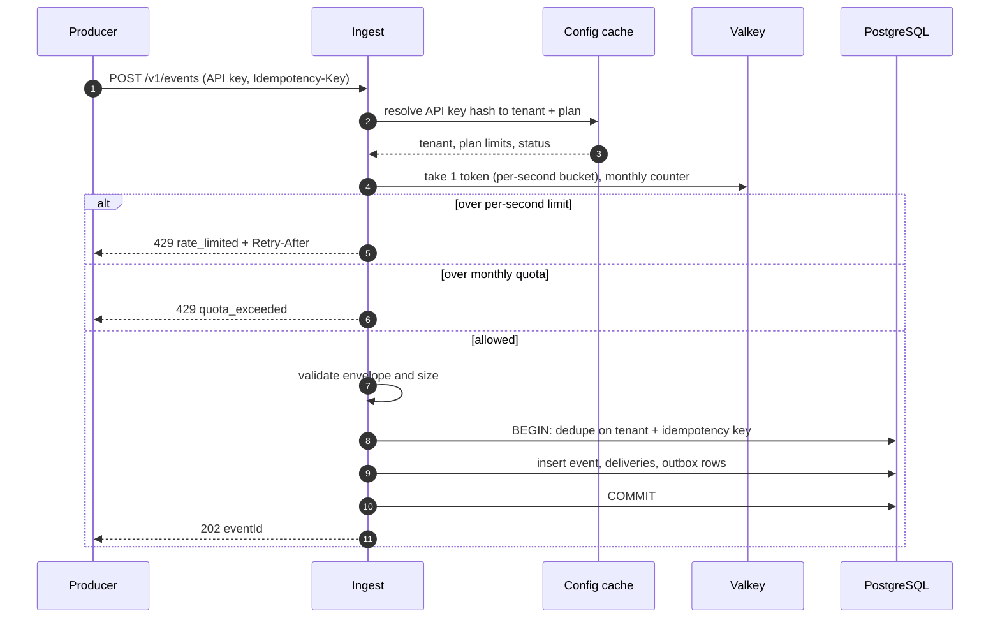
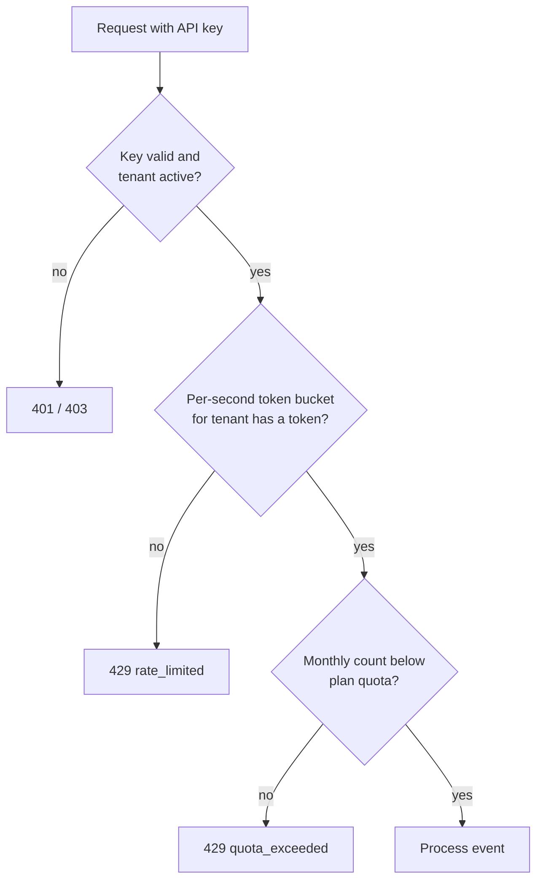
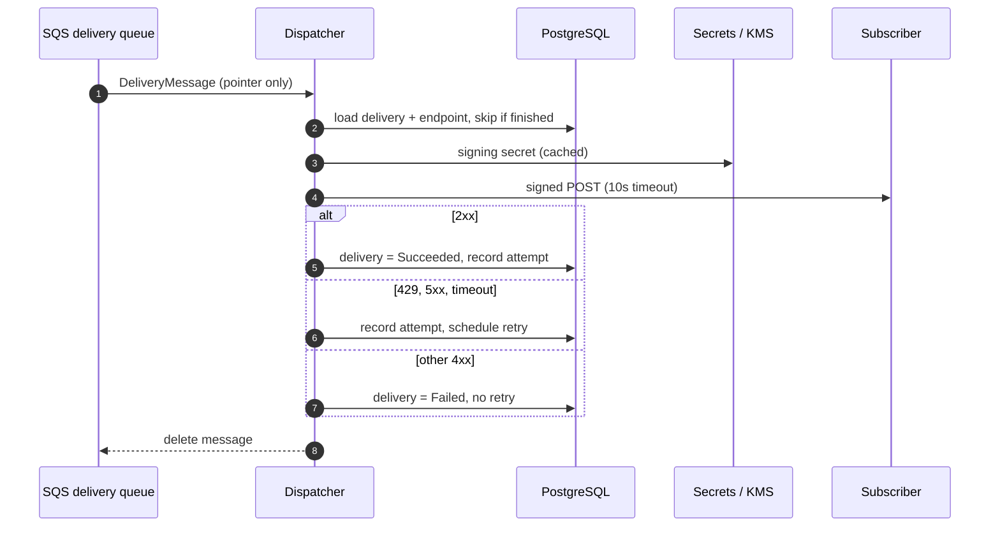
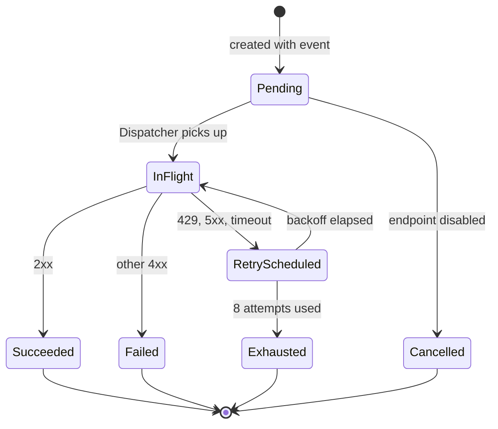
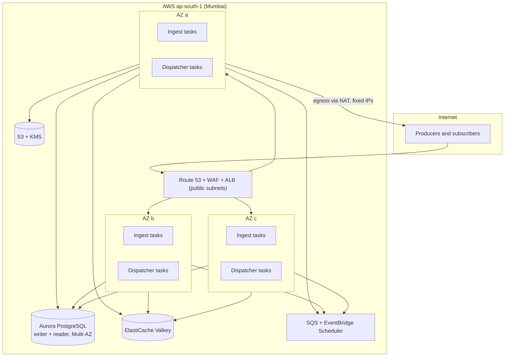

# Architecture

Status: **PROPOSAL v2, for owner review** (2026-10-20). Supersedes Baseline v1 once approved. Changes after approval go through `decisions.md`.
Companion docs: `tenancy-and-limits.md` (plans, rate limits, quotas, tenant config), `database.md` (in review), `contracts.md`.

Items marked **[DECIDE]** need an owner decision. They are collected in section 12.

## 1. Goal and scope

Webhook-as-a-service: tenants register endpoints and subscribe to event types; producers send events; the platform reliably delivers them (signed, retried, audited) to subscriber endpoints.

Launch scope:
- **One AWS region: `ap-south-1` (Mumbai)**, three availability zones. The public API is reachable from anywhere in the world; only the infrastructure is in India.
- **Multi-tenant from day one**, with per-tenant plan limits (events per second, events per month), persistent tenant configuration, and isolation between tenants.
- **Region-ready**: nothing in the design may block adding regions later (section 9). We do not build multi-region now.

Out of scope for v1: event transformation, per-endpoint ordering, customer-facing portal, non-HTTP destinations, active-active multi-region.

## 2. Tech stack

- **.NET 10 (LTS, to Nov 2028)**, C# 14.
- **AWS**, infrastructure as code (CDK in C#).
- Compute: **ECS Fargate** for Ingest and Dispatcher.
- Queueing: **SQS** standard queues + DLQs. Delays over 15 min: **EventBridge Scheduler**.
- Data: **PostgreSQL** (Aurora PostgreSQL, Multi-AZ) for config, events, deliveries; **S3** for audit logs and archive; **Secrets Manager / KMS** for secrets.
- Rate-limit state: **ElastiCache for Valkey** (Redis-compatible), see 5.
- Edge: **Route 53, WAF, ALB** in front of Ingest. **[DECIDE]** ALB vs API Gateway HTTP API: ALB is cheaper at sustained thousands of requests/s and has no hard 29s/10MB limits; API Gateway gives built-in usage plans we do not need because limits are per tenant in our code. Recommendation: **ALB + WAF**.
- Observability: CloudWatch logs and metrics (per-tenant dimensions), OpenTelemetry traces.

## 3. System overview

Components:

| Component | Where | Role |
|---|---|---|
| Ingest | `src/Ingest` | Public API. Authenticates tenant, enforces limits, validates, dedupes, stores event + deliveries + outbox in one transaction, returns `202`. |
| Outbox relay | `src/Ingest` (separate hosted service) | Publishes outbox rows to SQS, marks them published. |
| Control plane | `src/Ingest` (separate host) | Tenant, plan, API key, endpoint, subscription management. Split into its own service only when it grows. |
| Dispatcher | `src/Dispatcher` | Consumes deliveries, signs, POSTs, records attempts, schedules retries, flushes audit. |

## 4. Event ingest flow

Rules:
- Limit checks happen **before** any database work, so a flood is rejected cheaply.
- Duplicate idempotency keys return the original `202` and do **not** consume monthly quota (the per-second token is still spent).
- The `202` means the event is durably stored. Delivery is asynchronous.

## 5. Rate limits and quotas (summary)

Full detail in `tenancy-and-limits.md`.

| Plan | Events per second | Events per month |
|---|---|---|
| Basic | 100 | **[DECIDE]** cap |
| Advanced | 500 | **[DECIDE]** cap |
| Premium | 1,000 | **[DECIDE]** cap |

How it is enforced:
- **Per tenant, not per IP.** WAF only does coarse per-IP protection. Plan limits live in Ingest.
- **Token bucket in Valkey** (atomic Lua script), shared by all Ingest tasks. Burst capacity = 2 seconds of the plan rate.
- **Monthly counter in Valkey** (UTC calendar month), flushed to PostgreSQL `usage_monthly` every minute and on shutdown. PostgreSQL is the audit record; on a Valkey loss the counter is rebuilt from it (we may under-count up to one minute, never over-count).
- **If Valkey is down:** Ingest falls back to a local in-memory limiter at `plan rate / task count` (fail-open but bounded) and raises an alarm. We do not reject all traffic because of a cache outage.

## 6. Delivery flow

Delivery lifecycle:

Retry policy (unchanged from v1): max 8 attempts over about 24h; backoff ~30s, 2m, 10m, 30m, 1h, 4h, 8h, 10h with full jitter; up to 15 min via SQS delay, longer via EventBridge Scheduler; honor `Retry-After` (capped); per-endpoint circuit breaker; after exhaustion the message lands in the DLQ, an alarm fires, and the tenant can replay from the API.

### Fairness between tenants

A single shared queue lets one large tenant delay everyone. Proposal:
- **One delivery queue per plan tier** (`deliveries-premium`, `-advanced`, `-basic`), each with its own Dispatcher consumer pool and autoscaling. A Basic flood cannot starve Premium.
- **Per-endpoint concurrency cap** in Dispatcher so a slow subscriber cannot occupy all workers.
- **[DECIDE]** Whether very large tenants later get a dedicated queue (the design allows it; not built for launch).

## 7. Tenant configuration

Tenants "keep their configuration" in production:
- Stored in **PostgreSQL** (`tenants`, `plans`, `api_keys`, `endpoints`, `subscriptions`), managed through the control-plane API. Infrastructure code never contains tenant data.
- Ingest and Dispatcher read config through an **in-memory cache (TTL 30s) with explicit invalidation** on change, so a plan upgrade or disabled endpoint takes effect within seconds without a database read per event.
- Secrets (endpoint signing secrets, OAuth2 client secrets): **[DECIDE]** Secrets Manager per secret (simple, about $0.40 per secret per month, so cost grows with endpoints) vs. **envelope encryption in PostgreSQL with a KMS key** (cheap at scale, a little more code). Recommendation: **envelope encryption in PostgreSQL + KMS**; Secrets Manager only for platform secrets.
- Per-tenant overrides (custom limits for a negotiated customer) are rows, not code: see `tenancy-and-limits.md`.

## 8. Deployment topology (launch)

- Dispatcher egress goes through **NAT gateways with fixed Elastic IPs**, so tenants can allowlist our IPs.
- **Environments:** `dev`, `staging`, `prod` in separate AWS accounts, same IaC.
- **Targets (proposed):** availability 99.9%, RPO 5 min (Aurora PITR + Multi-AZ), RTO 1 hour. Disaster recovery to another region is a later step (section 9).
- **Autoscaling:** Ingest on CPU and request rate; Dispatcher per-tier on SQS queue depth and age.

## 9. Going global later (design rules now, build later)

"Available globally" has two meanings; we separate them:

| Need | Launch answer | Later |
|---|---|---|
| Producers worldwide can call the API | Yes, public endpoint, TLS | CloudFront or Global Accelerator in front for lower latency |
| Data stays in India | Yes, single region | Per-tenant `home_region`, regional "cells" |
| Survive a region outage | No (Multi-AZ only) | Cross-region DR, e.g. `ap-south-2` Hyderabad for India-only data |
| Low latency near the producer | No | Additional regional cells, tenant routed by home region |

Rules we follow from day one so none of this needs a rewrite:
1. **Cell design:** one deployment = one self-contained cell (API, queues, DB, cache). Adding a region means deploying another cell, not changing code.
2. **No region in code or data.** Region comes from configuration. IDs are prefixed ULIDs, globally unique without coordination.
3. **Every tenant has a `home_region`** column from the start (value `ap-south-1` today).
4. **Global tenant directory (later):** a small, replicated lookup that maps API key to home region, used by the edge to route.
5. **IaC is parameterized by region**; no hard-coded ARNs or AZs.

## 10. Delivery semantics, security, multi-tenancy (carried over)

- **At-least-once** delivery; receivers dedupe on `webhook-id` (= deliveryId, stable across retries). No global ordering; per-endpoint ordering out of scope.
- **Signing:** HMAC-SHA256, Standard Webhooks headers, secret per endpoint, rotation with two active secrets.
- **SSRF protection** in Dispatcher: HTTPS only, resolve and block private/link-local/metadata ranges, no redirects.
- **Producers:** API key per tenant, hashed at rest; optional JWT later.
- **Payload privacy:** encrypt at rest (KMS), redact in logs, no payloads in audit records.
- **Isolation:** every row and message carries `tenantId`, every query filters on it; fairness via per-tier queues and per-endpoint caps (section 6).

## 11. Capacity and the hard part (please read)

Plan limits are **per tenant**. Premium at 1,000 events/s is already a lot for one customer, and the platform total is the sum over tenants. Each event writes roughly `1 + fan-out × 2` rows (event, deliveries, outbox) plus attempt rows later.

Rough sizing: 20 tenants averaging 20% of limits (4 Premium, 6 Advanced, 10 Basic) is about 1,500 to 2,000 events/s, a few thousand row-writes per second with fan-out 3. A well-sized Aurora writer handles that, with batching and partitioned `events`/`delivery_attempts` tables. **This is the first scaling wall.**

Plan for it now, build it only when triggered:
- **Launch (sync outbox, as designed in D12):** simplest, strongest consistency. Valid up to roughly 2,000 sustained events/s platform-wide. **[DECIDE]**
- **Next step when DB write latency p95 or CPU passes a threshold:** insert an **ingest buffer**: Ingest writes the event to SQS/Kinesis and returns `202`; a fan-out worker writes to PostgreSQL in batches. Costs: dedupe responses become eventually consistent, and `202` durability moves from DB to the queue. We keep Ingest behind an `IEventStore` interface so this swap is local.
- **After that:** shard PostgreSQL by tenant (cells again).

Scale triggers are written in `tenancy-and-limits.md` and will be alarms, not guesses.

## 12. Decisions needed from the owner

| # | Decision | My recommendation |
|---|---|---|
| 1 | Monthly event caps for Basic, Advanced, Premium | You choose; placeholder table in `tenancy-and-limits.md` |
| 2 | Edge: ALB vs API Gateway HTTP API | ALB + WAF |
| 3 | Rate-limit state in Valkey (ElastiCache) | Yes |
| 4 | Endpoint secrets: Secrets Manager vs envelope encryption in PostgreSQL | Envelope encryption + KMS |
| 5 | One delivery queue per plan tier | Yes |
| 6 | Launch with sync transactional outbox; ingest buffer only on trigger | Yes |
| 7 | `home_region` on tenant from day one, cell design | Yes |
| 8 | Do deliveries (fan-out) count against plan limits, or only ingested events? | Ingested events only; cap endpoints per tenant by plan instead |
| 9 | Over-quota behavior: hard stop (`429`) or allow overage and bill | Hard stop for Basic; overage option for paid plans later |
| 10 | Availability and recovery targets (99.9%, RPO 5 min, RTO 1 h) | Accept for launch |
| 11 | Batch ingest endpoint (`POST /v1/events/batch`) so producers can reach 1k events/s cheaply | Yes, add after the single-event endpoint |

`database.md` stays **in review**; its changes from this proposal (plans, usage, `home_region`, encrypted secrets) are listed in `tenancy-and-limits.md` and apply only after you approve.
