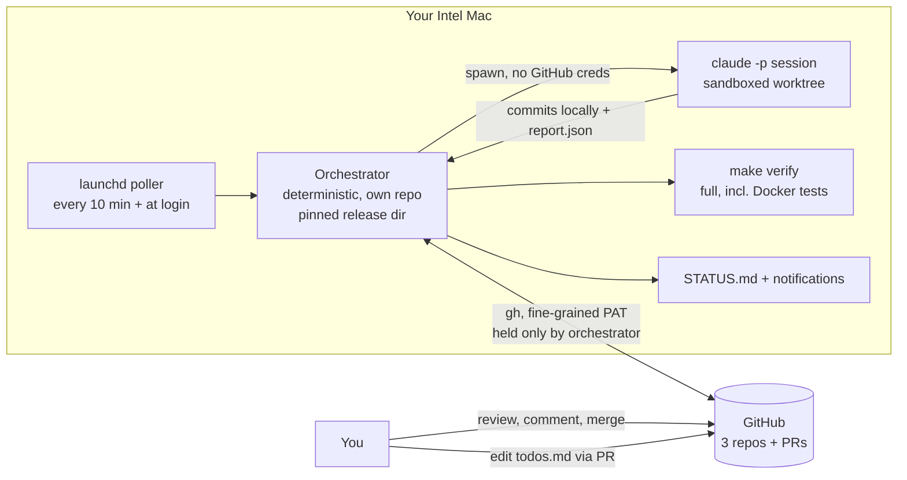
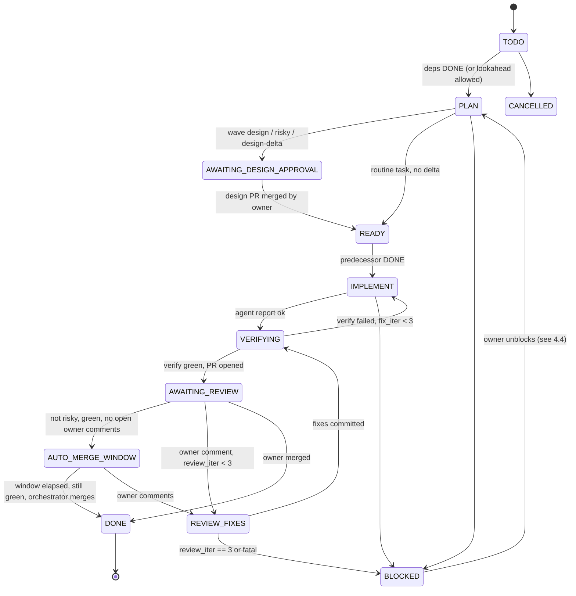

# Autonomous Task-Chain Agent: Architecture Spec

Status: **DRAFT v0.1 for owner review** (2026-10-20). Design only. Nothing is built, no repos created, nothing committed.
Audience: senior architect. Basics skipped. Claims about Claude Code come from official docs read 2026-10-20; anything not confirmed is tagged **UNVERIFIED**.

---

## 0. Executive summary

- A deterministic **orchestrator** (outside the agent's reach) owns state, credentials, pushes, PRs, merges and money. A fresh headless `claude -p` session does work inside one state at a time and never touches GitHub.
- **Two phases.** Phase 1: you approve the architecture, chain design and acceptance tests via a design PR (your merge = approval). Phase 2: tasks execute serially. Routine tasks auto-merge by orchestrator rule after a veto window; tasks tagged `risky` wait for your merge (option C).
- **The free GitHub plan is the biggest constraint.** Private repos on the free plan have no branch protection, required checks or enforced CODEOWNERS. The design therefore makes the agent **credential-less** (it cannot push or merge because it holds no token), instead of relying on a limited token. This is weaker than server-side protection and the spec says where.
- **Trigger:** a `launchd` poller on your Mac, not cloud routines. Cloud routines do support a "PR merged" trigger filter, but they run off-machine and cannot see comments as triggers. See D4.
- **Chaining:** your lean (approve the chain's design up front, then implement serially) is adopted with two amendments: design in **rolling waves of 3-5 tasks**, not the whole chain, and allow **PLAN-only lookahead** while a risky PR awaits you. See D5.
- **Repo split:** I'd challenge your 3 repos. See D2.
- **Budget:** Pro plan plus extra-usage credits, with a hard monthly cap set in your claude.ai settings as a backstop to the orchestrator's own ledger. See section 9.

Assumptions I made where you didn't answer are in section 15 (open decisions). Please attack them.

---

## 1. System overview



**Core invariant:** the LLM can read and write files in one git worktree and run sandboxed commands. It cannot reach GitHub, the orchestrator's code, or any token. Everything outward-facing (push, PR, comment reply, merge) is done by the orchestrator after deterministic checks.

---

## 2. Component responsibilities

| Component | Owns | Does NOT |
|---|---|---|
| **Orchestrator** (own repo, pinned release dir) | State derivation, locks, session launch/resume, diff policy checks, `make verify`, push, PR create, comment fetch and reply, auto-merge decision, cost ledger, STATUS, notifications | Write product code. Make design judgments. |
| **Agent session** (`claude -p`) | PLAN: draft instruction/design/tests. IMPLEMENT: code. REVIEW_FIXES: address comments. Write `progress.md` and a machine-readable `report.json` | Push, open PRs, merge, call `gh`, edit protected paths, change its own settings |
| **launchd job** | Wake-up cadence. Runs orchestrator once, exits | Hold state |
| **GitHub** | PRs, review comments, merged state, CI (when it exists), source of truth for "is it done" | |
| **You** | Edit `todos.md`, approve design PR, merge risky PRs, comment, set `risky` overrides | |

Sizing: the orchestrator should stay roughly 800-1500 lines. If it grows beyond that, it is becoming a framework. Stop.

---

## 3. Repos

### D2. Repo split

Current: `Global` (docs), `Ingest`, `Dispatcher`, plus your proposed orchestrator repo.

| Option | Cost | Complexity | Maintainability | Ops overhead | Skill fit |
|---|---|---|---|---|---|
| **A. Keep 3 + orchestrator (4 repos)** | Low now | High for agent: contracts change in Global first, then 2 consumers, linked PRs, no atomic change | Medium | 4 verify configs, 4 CI setups, cross-repo ordering | OK |
| **B. Monorepo `webhookgateway` (Ingest + Dispatcher + shared contracts + docs + db + infra) + orchestrator repo (2 repos)** | Low (repos were created today) | Low: one PR can change contract and both consumers; one `make verify` | High | One CI, one branch model | High (.NET solution) |
| C. Everything incl. orchestrator in one repo | Lowest | Lowest | **Breaks requirement 9** | | |

**Verdict: B.** Reasons:
1. D8/D11 in `decisions.md` already make Ingest host the control plane and Global own the DB schema and shared contracts. Every non-trivial feature touches 2-3 repos. With an agent, cross-repo ordering is the largest source of stuck chains: linked PRs, merge ordering, and "Global merged but Ingest PR failed" half-states.
2. Independent deployability does not need separate repos. ECS services deploy from one repo with per-service paths and image tags.
3. Your instinct on the orchestrator repo is right. The agent must not modify the system that runs it. Option C breaks that.

**What breaks under B:** if you later want different teams or access levels per service, you split then. History-preserving split of a monorepo path is routine. The reverse (merging 3 repos with atomic-history needs) is worse.

**What breaks under A (your current setup):** I'd enforce "one task = one repo = one PR" and put contract changes in separate preceding tasks. That works but multiplies the chain length and the number of design-delta PRs.

Success likelihood: B works well, ~85%. Swing factors: (1) you actually don't need per-service repo access control; (2) Docker build contexts and path-filtered CI are set up once.
If you keep A: ~65% that the chain runs without a cross-repo deadlock needing your help in the first 20 tasks. Swing factors: how many tasks touch contracts, and whether I enforce the one-repo-per-task rule.

This is your call. The rest of the spec is written so it works with either (task files carry a `repo:` field).

### Orchestrator repo: protection from the agent

- Separate repo, separate clone path `~/orchestrator/release` (read-only for the agent's sandbox, see section 8) and a dev clone you edit. The poller always runs the pinned **release tag**, never the dev clone's HEAD.
- The agent's worktrees live under `~/agent-work/<task-id>/` and nothing else is writable.

---

## 4. State model

### 4.1 Where state lives

D3. Decision: **state is derived, not stored.** The orchestrator computes each task's state from ground truth on every run:

| Signal | Source |
|---|---|
| Task exists, order, deps, `risky` | `tasks/NNN-slug/instruction.md` front-matter on `main` |
| Branch exists, last SHA | `git ls-remote` |
| PR open / merged / closed, mergedBy, mergedAt | `gh pr view --json` |
| Unresolved review threads and owner comments | `gh api` (GraphQL reviewThreads) |
| CI / verify result | `gh pr checks` (once CI exists) plus orchestrator's own `make verify` run record |
| In-flight attempt | local lock + `runs/<task>/<n>.json` (cache, rebuildable) |

`progress.md` is a **hint for the agent**, never read by the orchestrator to decide transitions. Local SQLite or JSON is a cache and a cost ledger only.

| Alternative | Cost | Complexity | Maintainability | Ops | Skill fit | Likelihood it holds |
|---|---|---|---|---|---|---|
| **Derived from GitHub + task files (chosen)** | Low | Medium (many API calls) | High: nothing to corrupt | Low | High | ~85% |
| Stored `state.json` committed to repo | Low | Low | Medium: drifts from reality; needs direct push to `main` (not allowed) | Medium | High | ~55% |
| Local SQLite as source of truth | Low | Low | Low: lost with the disk, not visible to you | High | Medium | ~40% |

Swing factors: GitHub API rate limits and latency (5000 req/h on PAT, ample for 10-minute polling of a few tasks); and whether "derived" logic stays simple. If derivation exceeds ~15 rules, I'd add a persisted state with a reconcile check.

Cost ledger is the one piece of non-derivable state. Back it up: append-only JSONL, copied daily to the orchestrator repo's private `ledger` branch by the orchestrator.

### 4.2 State machine (your proposal, attacked)

Your proposal: `TODO > PLAN > AWAITING_DESIGN_APPROVAL > IMPLEMENT > AWAITING_MERGE > REVIEW_FIXES > DONE (+ BLOCKED)`.

**This breaks under three conditions:**
1. **Per-task design approval vs per-wave.** With D5 (wave design), most tasks don't have their own AWAITING_DESIGN_APPROVAL. Only wave-0 and risky tasks do.
2. **REVIEW_FIXES is not a place, it's an excursion.** After fixes the task returns to awaiting merge, so it's a sub-loop with a counter. Modeling it as a peer state hides the "iteration n of 3" invariant.
3. **Auto-merge needs a waiting state.** Between "PR green" and "orchestrator merges" there is a veto window (see 6.3). Without a state, you'd merge by timer with no visibility.

Amended machine:



### 4.3 Transitions and guards

| Transition | Guard (all deterministic) |
|---|---|
| TODO → PLAN | `deps` all DONE, or lookahead rule 7.3 permits; no other task in IMPLEMENT/VERIFYING (serial) |
| PLAN → AWAITING_DESIGN_APPROVAL | Design PR opened by orchestrator after path-policy check |
| AWAITING_DESIGN_APPROVAL → READY | `gh pr view` shows merged **and** mergedBy == owner |
| READY → IMPLEMENT | Predecessor DONE; budget ledger under limits; `main` fast-forwarded locally |
| IMPLEMENT → VERIFYING | `report.json` valid; commits exist; diff within path policy; protected paths untouched |
| VERIFYING → AWAITING_REVIEW | `make verify` exit 0 in orchestrator's own run; acceptance tests for this task pass; pending-manifest edit is legal (see 10.2) |
| AWAITING_REVIEW → AUTO_MERGE_WINDOW | `risky == false`, checks green, zero unresolved owner threads, no `hold` label |
| AUTO_MERGE_WINDOW → DONE | window elapsed (default 12h, since you review daily), head SHA unchanged, re-verify green on current `main` merge-base, then `gh pr merge --merge` |
| any → REVIEW_FIXES | New unaddressed owner review comment on PR head; `review_iter < 3` |
| REVIEW_FIXES → BLOCKED | `review_iter == 3`; escalation message lists unresolved threads |
| any → BLOCKED | See failure-mode table (section 12) |

**Counters.** `review_iter` counts pushes made in response to owner comments (cap 3, your requirement). `fix_iter` counts verify-fix cycles within IMPLEMENT (separate cap 3). Both are derived from commit trailers (`Task: 007`, `Iter: review-2`) so they survive a lost cache.

### 4.4 BLOCKED and resuming

BLOCKED carries a reason code (`review_cap`, `verify_cap`, `budget`, `usage_limit`, `policy_violation`, `agent_asks`, `merge_conflict`, `external`). Resume paths:
- `usage_limit` and `budget` window: **automatic** retry after reset.
- Others: you comment on the PR or edit the task file; or run `orch unblock <task> [--reset-iter]`.

---

## 5. File templates

Location: task files live in the code repo (`tasks/NNN-slug/`) on the task's branch and reach `main` with the task PR. The wave design lives in `docs/design/wave-N.md`. The `todos.md` file lives at repo root.

### 5.1 `todos.md` (the only thing you write)

Markdown checklist, order = chain order. The orchestrator parses it; unknown lines are ignored.

```markdown
- [ ] Ingest: POST /v1/events accepts and stores an event (202) #risky
- [ ] Ingest: outbox relay publishes DeliveryMessage to SQS
- [ ] Dispatcher: sign payload with Standard Webhooks and POST
```

Rules: `#risky` forces risky. IDs (`001`, `002`...) are assigned by the orchestrator when it first expands an item and written back to `todos.md` via the design PR. You edit `todos.md` only via PR.

### 5.2 `tasks/NNN-slug/instruction.md` (the contract)

```markdown
---
id: 003
title: Outbox relay publishes DeliveryMessage to SQS
repo: webhookgateway
depends_on: [002]
risky: false            # orchestrator proposes; owner may set true, never false->true->false by agent
risk_reasons: []        # schema | auth | infra | contract | dependency | security
est_size: M             # S|M|L; L is split before PLAN completes
acceptance_tests: tests/acceptance/Task003/
status_source: derived  # informational; never edited by agent
---
## Goal
## Context (links into docs/, decisions D#)
## Constraints (tech, perf, compat, "expand then contract" for migrations)
## Acceptance criteria (each maps to >=1 named test in acceptance_tests)
## Out of scope (explicit; agent must not touch)
## Protected paths for this task (additional to global list)
## Open questions (agent may append; any entry sets BLOCKED(agent_asks) at next gate)
```

Agent may not modify front-matter fields other than appending to `risk_reasons`, which can only escalate risk.

### 5.3 `tasks/NNN-slug/progress.md` (resume hint)

```markdown
# Progress: 003
Updated by: agent (end of every session) | Last verified-by-orchestrator SHA: <sha>
## Done
## In progress (file, function, what's left)
## Remaining
## Decisions made (-> decisions.md candidates)
## Open questions
## Notes for next session (gotchas, commands that work)
```

The orchestrator also writes `.orch/last-run.json` (not agent-writable) which the agent prompt includes: SHA, verify output tail, review comments.

### 5.4 `docs/design/wave-N.md` / `tasks/NNN/design.md`

```markdown
# Design: wave N (tasks 003-007)
## Chain overview and dependency graph
## Per-task design (interfaces, data shapes, error handling, observability)
## Contract/schema changes (link to docs/contracts.md diffs)
## Test plan and acceptance test index
## Assumptions that later tasks rely on  <- the "design-delta trigger list"
## Risk tagging proposal with reasons
## Risks and rollback
```

"Assumptions that later tasks rely on" is the key section: a design-delta PR is required if implementation invalidates any of them.

---

## 6. Orchestrator behaviour

### 6.1 Run loop (each launchd tick, ~10 min)

1. Acquire lock (`flock`-style with PID + start time; stale if PID dead or heartbeat older than 20 min).
2. `git fetch` all repos. `gh` queries for open PRs and merged state.
3. **Reconcile** (section 7.1) → derive every task's state.
4. Choose at most **one action** (serial invariant), by priority: merge-ready auto-merge → review-fix needed → verify retry → implement next → plan next.
5. Run the action; update ledger; render STATUS; notify on change.
6. Release lock.

Interrupted mid-step is safe: every step is idempotent given step 3 re-derives state (see section 12).

### 6.2 Agent invocation

`claude -p` with, per documented flags: `--permission-mode dontAsk` (or `manual` with `--permission-prompts none`), explicit `--allowedTools`, `--disallowedTools`, `--max-turns`, `--max-budget-usd`, `--output-format json` (returns `session_id`, `total_cost_usd`), `--resume <session_id>` for resumption. No `--bare` (it ignores OAuth). No `bypassPermissions`.

Prompt = state-specific template + paths to instruction/progress/design + `.orch/last-run.json`. A resumed session is used only for REVIEW_FIXES within the same task; PLAN and IMPLEMENT start fresh and rebuild from files (context rot is worse than re-reading).

### 6.3 Auto-merge (option C)

- Merge identity: the orchestrator's PAT. The agent never has it.
- Window: default 12h from "green and ready", configurable per task (`merge_window_hours`). You review daily, so a daily veto window is the point: a comment, the `hold` label, or a new push cancels it.
- Always `--merge` (no squash), matching `workflow.md`. Delete the branch after.
- Re-verify on the current `main` before merging, because `main` may have moved.

### 6.4 `risky` rule

The orchestrator proposes `risky` from a fixed matcher on the diff and the design: any change under `db/migrations/**`, `infra/**`, `.github/**`, auth/crypto namespaces, `docs/contracts.md`, `*.csproj` package additions, or secrets-adjacent config. The agent can only escalate. You can set true or false in the design PR (you are the approver of that PR). Rating: this rule catches the obvious classes, misses semantic risk (e.g., a retry-loop bug). That's what the veto window is for.

---

## 7. Reconcile-on-resume and chained tasks

### 7.1 Reconcile procedure (runs at the start of every tick and every session)

1. Parse `todos.md` and task front-matter from `origin/main`.
2. For each task derive: branch, PR, mergedBy, head SHA, unresolved threads, verify record for head SHA.
3. Detect and repair, in order:
   - Local worktree dirty or ahead of remote with no PR → run policy checks, then continue VERIFYING (no LLM call).
   - Remote branch ahead of the last recorded SHA → someone (you) pushed; treat as human edit, re-verify before any agent work.
   - PR merged but local task marked in-flight → mark DONE, delete worktree, fast-forward `main`.
   - PR closed unmerged → BLOCKED(`external`), notify.
   - `main` moved since branch base → rebase attempt by orchestrator; conflict → BLOCKED(`merge_conflict`) or a fix session.
   - `progress.md` claims done but commits or tests disagree → trust git and tests; instruct the agent to correct `progress.md`.
4. Output the derived-state table to `runs/reconcile-<ts>.json` (debug aid).

The agent receives the same reconciled facts in its prompt and is told: "`progress.md` is a hint; if it conflicts with `git log` or test results, the latter win."

### D5. Chained task strategy

| Strategy | Cost | Complexity | Maintainability | Ops | Skill fit | Fails when |
|---|---|---|---|---|---|---|
| **Strict serial** (plan, implement, merge, then next) | Low | Low | High | Low | High | Your review latency gates every task. With risky tasks this is ~1 task/day. |
| **Stacked PRs** | Medium | **High**: retargeting, rebasing after each merge, orchestrator must manage stack topology | Low | High | Medium | Any review comment on a low PR rewrites everything above it. With a 3-iteration cap that's a cascade. Worst on the free plan where I cannot auto-retarget via protection rules. |
| **Approve chain design first, then serial per-task PRs (yours)** | Medium (up-front design tokens) | Medium | High | Low | High | The design rots: task 6's design was written before task 2's reality. Large design PRs are rubber-stamped, not read. |
| **Recommended: your option, in rolling waves + PLAN lookahead** | Medium | Medium | High | Low | High | See below |

**Attack on your lean:** designing the *whole* chain up front puts a 20-task design in one PR. Review quality of big PRs is poor (you will skim), and the later tasks' details are the ones most likely to change. "Design delta PR for any deviation" then becomes the common path.

**Amended:**
1. **Wave design:** each design PR covers the next **3-5 tasks** with full per-task detail, and later tasks stay as one-line items. Wave N+1 design is drafted while wave N implements, and goes up for your approval before wave N's last task completes.
2. **Design-delta rule:** a delta PR is required only if implementation invalidates an item in the design's "Assumptions that later tasks rely on" list, or if the diff touches a risky path not anticipated. Routine drift (names, internals) is recorded in `progress.md` and `decisions.md`, no PR.
3. **PLAN lookahead, no IMPLEMENT lookahead:** while task N sits in AWAITING_REVIEW (e.g., risky, waiting for you), the orchestrator may run PLAN for N+1 on a branch based on N's branch, so the next day starts with a ready plan. It never implements ahead (that would be stacked PRs by another name).

Success likelihood of the amended strategy: ~75% that fewer than 1 in 5 tasks need a delta PR. Swing factors: (1) how stable your requirements are, and (2) how well the "assumptions" section is actually written by the planner. If deltas exceed ~30%, shrink waves to 2.

Strict serial is the fallback and costs only throughput. If the first 10 tasks show 3+ deltas, fall back to waves of 1.

---

## 8. Security and permission model

### 8.1 Threat model

The agent can be wrong, can be manipulated by content it reads (docs, PR comments from others, dependencies), and can optimize for "tests pass" instead of correctness. Prompts alone are not a control. Controls must exist outside its process.

### D6. Credential model on the free plan

Facts: on private free-plan repos, branch protection, required status checks, rulesets and CODEOWNERS enforcement are unavailable. (Public repos get them.) That is a GitHub plan limit I know generally; **I did not re-verify it against GitHub's current pricing page this session. Please check it before relying on it.** Fine-grained PATs cannot be limited to "push to branches except main".

| Option | Cost | Complexity | Maintainability | Ops | Skill fit | Strength |
|---|---|---|---|---|---|---|
| **A. Credential-less agent; orchestrator pushes, opens PR, replies, merges (chosen)** | Free | Medium: orchestrator mediates every outbound action; agent can't use `gh` | High | Low | High | **Strong against the LLM**, none against a compromised orchestrator or your own mistakes |
| B. Agent gets fine-grained PAT (contents:write, pull_requests:write) | Free | Low | High | Low | High | Weak: contents:write permits pushing `main` on unprotected repos. Safety lives in a hook only. |
| C. Separate bot account with write access | Free (2nd free account; GitHub ToS permits one machine account) | Medium | Medium | Medium | High | Same weakness as B; bot can push `main` |
| D. GitHub Pro ($4/mo) + protection + B | ~₹350/mo | Low | High | Low | High | **Strongest**: server-side enforcement; defense in depth with A |

**Decision: A now, D when you upgrade (your plan).** After D, keep A anyway; the two compose.

Consequences of A to accept:
- The agent cannot read PR comments itself. The orchestrator fetches owner comments into `.orch/review-comments.json` and posts the agent's per-comment replies from `report.json` (`replies: [{comment_id, text, resolved_by_sha}]`).
- The agent cannot run `gh issue` / `gh pr` at all. It can't self-report CI, only run the local verify subset.
- A bug in the orchestrator's policy check is the single point of failure. Mitigation: policy check is ~50 lines, unit-tested, and gets a mutation test in the dry run (section 14).

Likelihood that the agent never lands an unreviewed change on `main` under A: ~95% against LLM mistakes; ~70% against prompt-injection attempts that target the orchestrator parsing `report.json` (swing factors: strictness of schema validation; no shell expansion of agent-supplied strings).

Residual risk: **you** (or the orchestrator PAT) can still push `main`. And a PAT in an env var readable by your user is readable by any process you run. Keep the PAT in the macOS Keychain, readable only by the orchestrator binary.

### 8.2 Path policy (enforced by orchestrator before push, and by hooks during the session)

Protected globally: `tests/acceptance/**` (after design merge), `.claude/**`, `.github/**`, `Makefile` and `scripts/verify*`, `CODEOWNERS`, `.orch/**`, `todos.md`, `docs/decisions.md` (append-only exception: agent may add lines at bottom), `tasks/*/instruction.md` (front-matter fields beyond `risk_reasons`), anything outside the worktree.

Enforcement layers:
1. **Permission deny rules** in project `.claude/settings.json` (`Edit(...)`, `Write(...)`, `Bash(git push *)`, `Bash(gh *)`, `Bash(curl *)` etc.). Deny rules apply even under bypass (per docs).
2. **PreToolUse hooks** on `Edit|Write` returning `permissionDecision: deny` for protected paths; hooks run in `-p` mode. The docs say the hook `if` field is best-effort, so hooks are a second layer, not the first.
3. **Post-session diff check by the orchestrator** against the policy. This is the authoritative check: it cannot be bypassed by a tool the agent invents.
4. `Stop` hook: block stopping until `make verify-fast` passes, with a loop guard (doc field name for loop guard is **UNVERIFIED**; the orchestrator enforces the turn cap regardless).

A hook/permission file the agent can edit protects nothing, so `.claude/**` is outside the agent's write set and the orchestrator checks its checksum before each session.

### D7. Sandbox vs devcontainer

| Option | Cost | Complexity | Ops | Fit | Notes |
|---|---|---|---|---|---|
| **Seatbelt sandbox (`sandbox.enabled`, `failIfUnavailable: true`, `allowedDomains` allowlist, `allowUnsandboxedCommands: false`)** | Free | Low | Low | High | Covers **Bash only**; file tools, MCP and hooks are outside it, so deny rules are still needed |
| Devcontainer with `init-firewall.sh` | Free | High on Intel Mac: Docker-in-Docker for Testcontainers, slower I/O | High | Medium | Docs warn it's for trusted repos; with permissions skipped, a malicious project can exfiltrate container contents |
| Nothing (rules only) | Free | Low | Low | | Unattended runs with no egress control: no |

**Decision: Seatbelt sandbox for the agent; the orchestrator, not the agent, runs Docker-dependent verification outside the sandbox.** The agent runs `make verify-fast` (build, analyzers, unit tests, acceptance tests that need no containers). Orchestrator runs full `make verify` afterwards and feeds failures back (this uses one `fix_iter`). Reason: Testcontainers needs the Docker socket, which a Bash sandbox most likely blocks (I did not confirm; check in the dry run).

Network allowlist: `api.anthropic.com`, NuGet (`api.nuget.org`, `*.nuget.org`), nothing else by default. `github.com` is **not** allowed, consistent with the credential-less design. Anything else is a BLOCKED(`policy_violation`) the owner can approve by editing the allowlist (in the orchestrator repo).

### 8.3 Secrets

- Orchestrator PAT: Keychain only. Scope: the repos in use; permissions: contents, pull requests, metadata. No admin, no workflows.
- Claude auth: `claude setup-token` yields a one-year token (`CLAUDE_CODE_OAUTH_TOKEN`) for Pro; keep it in Keychain, injected only into the `claude -p` child process.
- **`ANTHROPIC_API_KEY` must be unset** in the poller's environment. Docs state a present API key always wins in `-p` mode, so a stray export silently moves billing from your plan to API pay-per-token.
- No AWS credentials anywhere in the agent's environment. All AWS work is out of scope (matches `workflow.md`).

---

## 9. Trigger mechanism and auth

### D4. What starts a run

What I verified in the docs (read today; subagent-sourced, then summarized):

| Mechanism | "PR merged" trigger | PR comments trigger | Needs your Mac on | Runs local Docker/tests | Notes |
|---|---|---|---|---|---|
| **launchd poller (chosen)** | Via polling `gh`, ≤10 min lag | Via polling | Yes (catches up after wake) | **Yes** | Zero tokens spent while idle |
| Desktop scheduled tasks | No (time-based) | No | App open **and** awake | Yes | Manual-mode tasks stall on prompts |
| Cloud routines | **Yes**: GitHub events, `pull_request` with an "Is merged" filter | **Not listed** as events (UNVERIFIED) | No | Unconfirmed; cloud sandbox, unlikely local Docker | Counts toward plan usage; hourly caps (e.g., 30 per task); needs claude.ai login; hidden with API-key auth |
| GitHub Actions + claude-code-action | Yes (workflow events) | **Yes** (`pull_request_review_comment`, `issue_comment`) | No | GitHub runner minutes (private: limited free minutes) | Triggering user needs write access, bots rejected unless allowed; bills via API key or OAuth secret |
| Cloud auto-fix PR | Not stated (UNVERIFIED) | Reacts to review comments and CI failures | No | Cloud | Opt-in per PR; doesn't handle merge conflicts |

**Decision: launchd poller + `claude -p`.** It is the only option that (a) is deterministic, (b) runs on your machine against local Docker, (c) keeps the credential-less model, (d) costs nothing while idle. Cloud routines' real advantage, the merge-event trigger, saves at most 10 minutes of latency and costs you the control model.

| | Poller | Cloud routine + Actions hybrid |
|---|---|---|
| Cost | Low | Medium (plan usage + runner minutes) |
| Complexity | Low | High: two execution environments, two credential stories |
| Maintainability | High | Medium |
| Ops overhead | Low (one plist) | High |
| Skill fit | High | Medium |
| Success likelihood | ~85% | ~55% |

Swing factors for the poller: (1) a Mac that's asleep for days (tolerated, just slow); (2) `launchd` plist and Keychain access from a non-interactive context (a known sharp edge: Keychain prompts can block; test early).

Later option, optional: a cloud auto-fix on a PR is worth testing as a *supplement* for review comments when the Mac is off. Not in scope for v1.

### Sleep/wake behaviour

`StartInterval` timers do not wake a sleeping Mac, and missed intervals coalesce into one run at wake. This is fine: the loop is idempotent. Add `RunAtLoad` and a `WatchPaths` on the lock directory for no benefit; skip. Optional `pmset repeat wakeorpoweron` is not recommended; `caffeinate` during a session only (orchestrator wraps the child process) prevents sleep mid-run. A crash or sleep mid-session leaves a stale lock and a dirty worktree; section 12.

### D8. Billing: subscription vs API key

Facts: `claude setup-token` makes a long-lived token for Pro/Max/Team usable by `-p`. `-p` runs draw from the same plan usage as interactive. Pro supports "extra usage" credits with a monthly cap you set in Settings > Usage. `--max-budget-usd` and `total_cost_usd` exist, but cost is a client-side estimate, not billing. The docs say Anthropic disallows third-party products offering claude.ai login; whether scripted personal use of your own subscription is covered is **UNVERIFIED**. Read the current terms before relying on it.

| Option | Cost | Complexity | Predictability | Skill fit |
|---|---|---|---|---|
| **Pro + extra usage credits with a hard monthly cap (₹5-9k)** | Plan fee + capped overage | Low | Medium: windowed limits interrupt runs | High |
| API key, pay per token, console spend limit | ≈ ₹5-9k flat cap | Low | **High**: no windows, clean per-run cost | High |
| Pro only | Plan fee | Low | Low: windows will stall a chain | |

**My recommendation: start with Pro + extra usage (capped), measure real cost per task in the dry run, and decide.** If usage-window stalls exceed ~20% of tasks, switch to an API key, because a chain that stalls every other afternoon is not autonomous. Likelihood that Pro alone sustains a daily-review pace with design waves: **~35%**; Pro + credits: ~70%; API key: ~85%. Swing factors: tokens per task (unknown until measured) and model mix.

---

## 10. Testing policy and CI gates

### 10.1 One verify command

`make verify` (or `./build.sh verify`; Makefile is fine on macOS) is the *only* gate and runs identically locally, in the orchestrator, and in CI:
1. `dotnet format --verify-no-changes`
2. `dotnet build -warnaserror` with analyzers (nullable on, `TreatWarningsAsErrors`)
3. Unit tests
4. Acceptance tests whose task ids are **not** in the pending manifest (10.2)
5. Integration tests (Testcontainers PostgreSQL, LocalStack SQS)
6. Thin e2e smoke suite (docker-compose)

`make verify-fast` = steps 1-4 (what the sandboxed agent runs). `make verify-task TASK=003` runs task 003's acceptance tests only.

### D9. Acceptance tests as contract: red tests on `main`

Your position: write failing acceptance tests in the design PR; you approve them; implementation must make them pass without editing them; protect `tests/acceptance` via CODEOWNERS.

**This breaks as stated because:** merging failing tests to `main` makes `make verify` red on `main` until the task lands, so required checks (once you buy Pro) block every unrelated PR, and CODEOWNERS isn't enforced on the free plan anyway.

Fix:
- Tests carry a trait `Task=003`. `tests/acceptance/pending.txt` lists task ids whose tests are *expected to fail*. `make verify` skips pending ids (they're compiled, not run), so `main` stays green. `make verify-task TASK=003` runs them.
- The task's implementation PR **deletes its own line** from `pending.txt` (the only permitted edit under `tests/acceptance`). The orchestrator checks: (a) the diff under `tests/acceptance` is exactly that one removed line, (b) `verify-task` passed before the removal, (c) the test files' hashes equal their hashes at design-merge (recorded in the wave design PR).
- Enforcement is the orchestrator's hash and diff check, not CODEOWNERS (add CODEOWNERS later for the human-readable intent).

Residual risk: the agent special-cases the tests (hard-coded outputs). Mitigations: acceptance tests assert behaviour through public interfaces with varied inputs; the veto window; and a periodic "adversarial review" task by a separate session (cheap, optional).

Likelihood this protects the contract: ~80%. Swing factors: test quality (a weak test is a weak contract) and whether you actually read the tests in the design PR.

### 10.2 CI

Phase-0 prerequisite (it doesn't exist yet): GitHub Actions runs `make verify` on every PR and on `main`. On the free plan, it reports status but cannot block merging; the orchestrator uses it as an extra signal, and its own local verify is authoritative. Private-repo Actions minutes are limited on free; the Testcontainers suite may be slow on hosted runners. Measure it.

Real dependencies: containers for PostgreSQL and LocalStack in integration tests; smoke suite stays <10 tests, run only in `make verify`, not on every agent iteration.

---

## 11. Cost and usage controls

Budget: ₹5-9k/month ≈ $60-105 at roughly ₹85-88 per USD (check the rate). Per-task numbers are **unknown until the dry run**. Do not plan capacity on guesses.

| Control | Mechanism |
|---|---|
| Per-session | `--max-turns`, `--max-budget-usd` (overshoot possible: leave headroom) |
| Per-task | Orchestrator sums `total_cost_usd` across its sessions (resumed sessions report cumulative; use the last, not a sum) and ceilings at `task_budget_usd` → BLOCKED(`budget`) |
| Per-day / per-month | Ledger-based; orchestrator refuses to start a session over the cap; backstop is the extra-usage monthly limit in claude.ai |
| Model split | Opus for PLAN/design waves; Sonnet for IMPLEMENT and REVIEW_FIXES. Dry run measures whether Sonnet-only is good enough |
| Usage-window limit hit | BLOCKED(`usage_limit`), auto-retry after reset |
| Kill switch | `~/orchestrator/STOP` file stops all new sessions |
| Anomaly | Session > 3x median task cost → stop and notify |

Dry run goal: derive median and p90 cost per task size (S/M/L). Convert to "tasks per month at budget" before committing to a chain length.

---

## 12. Failure modes and recovery

Recovery principle: **idempotent steps + re-derive**. Any crash is handled by the next tick.

| Failure | Detection | Recovery |
|---|---|---|
| Mac sleeps or reboots mid-session | Lock heartbeat stale; PID gone | Next tick: reconcile; worktree dirty → run policy + verify on what's there; else re-launch IMPLEMENT (fresh session reads `progress.md` + git) |
| `kill -9` of orchestrator mid-push | Remote branch exists with no PR | Reconcile sees branch, no PR, verified SHA → open PR |
| PR opened, comment reply post failed | Comment has no reply from orchestrator | Replies are posted by comment id, idempotent (marker in body) |
| Agent claims done but tests fail | Orchestrator's verify | `fix_iter` loop; at 3 → BLOCKED(`verify_cap`) |
| Agent edits protected path | Diff check (and hook) | Discard commit, BLOCKED(`policy_violation`), notify |
| Review ping-pong | `review_iter == 3` | BLOCKED(`review_cap`) with summary of unresolved threads |
| Comment from someone other than owner | Author != owner login | Ignored for state and **not** shown to the agent as instructions (prompt injection) |
| You push to the task branch | Remote SHA != recorded | Treated as human work; re-verify; no agent overwrite, ever force-push forbidden |
| `main` moved, conflict | Rebase fails | One fix session with conflict context; else BLOCKED(`merge_conflict`) |
| Usage window / budget exhausted | CLI error / ledger | BLOCKED, auto-resume |
| Claude CLI auth expired | `-p` stdout error | BLOCKED(`external`), notification |
| `gh` auth / PAT expired | HTTP 401 | Same |
| GitHub API outage | Retries then skip tick | Next tick |
| Orchestrator bug merges something wrong | n/a | Auto-merge only after veto window and re-verify; `main` is revertible (you review daily). **Single biggest residual risk** |
| Duplicate orchestrator instances | Lock | Second exits |
| Token or disk full | Pre-flight checks | BLOCKED(`external`) |
| Agent loops with no progress | Turn cap, anomaly threshold | Kill, BLOCKED |

Anything the orchestrator can't classify → BLOCKED with a notification. Never retry unknown failures silently.

---

## 13. Observability: progress tracker

`STATUS.md` is regenerated by the orchestrator every tick (not by the LLM). Published two ways: a local file `~/orchestrator/STATUS.md`, and a single pinned GitHub issue in the code repo (the orchestrator edits it; issue edits don't touch `main`).

```
WebhookGateway chain          updated 2026-10-21 09:10
Done 7 | In progress 1 | Awaiting you 2 | Blocked 0 | Pending 12   (22 total)
[#######---..........]  32%   by task | wave 2 of 5
Cost: this month ₹3,120 / ₹7,000 cap (≈ est.)  | today ₹210
| # | Task                    | State             | Branch | PR  | Iter | Cost | Since |
| 8 | Outbox relay            | AWAITING_REVIEW   | ...    | #12 | 0/3  | ₹180 | 6h    |
Awaiting you: PR #12 (risky: schema) design delta; PR #13 wave-3 design
```

Notifications (macOS `osascript`): task entered AWAITING_REVIEW for a risky task, BLOCKED, wave design ready, auto-merge performed, budget at 80%. Daily digest at 08:00 even if nothing changed? No: only on change. You review daily, so a morning summary is the one scheduled exception.

---

## 14. Rollout plan

### D10. Bootstrapping the orchestrator

The orchestrator cannot go through its own gated chain. Options:

| Option | Risk | Cost |
|---|---|---|
| **A. Human-supervised build, interactive Claude sessions, in the orchestrator repo, no autonomy, tagged releases (chosen)** | Low | A few sessions; your review |
| B. Orchestrator v0 minimal (shell script), then let it build v1 under its own gate | Self-modifying: v0 bugs compound | Low |
| C. Build it entirely autonomously from a spec | Unbounded | Low cost, high risk |

**Choice: A.** The orchestrator is the trust root. It's small, you can read all of it, and it ships by **release tags** that you cut by hand. After rollout, changes to it are done by you with interactive Claude, never by the agent chain. Its own tests include the policy-check mutation tests (flip a rule, tests must fail).

### Phases

| Phase | Output | Exit criterion |
|---|---|---|
| **0 Prerequisites** | `gh` installed and authenticated; PATs; Keychain items; Docker confirmed; settings for Pro extra usage; decide D2 repo layout; verify GitHub plan claims (8.1) and the terms question (9) | Checklist signed off |
| **1 Foundation docs (this spec + yours)** | Spec approved. `docs/decisions.md` entries; `workflow.md` replaced by this model | You approve |
| **2 Build orchestrator (human-supervised)** | Repo, unit tests, policy check, reconcile, STATUS. Tagged v0.1 | Test suite green; mutation tests green |
| **3 Dry run** in a throwaway scratch repo you create (private, disposable) | 3 chained trivial tasks: (1) library function, (2) CLI uses it, (3) change touching a "risky" path. Exercise on purpose: `kill -9` mid-session, laptop sleep, a review comment (fix cycle), 3 review iterations → escalation, a protected-path edit attempt, expired token, `main` moved underneath, a usage-limit simulated block, auto-merge window and a veto via `hold` | Every failure-mode row in section 12 observed at least once; cost per task measured |
| **4 Wave-0 design PR on the real project** | Design + acceptance tests for the first 3-5 tasks | You merge it |
| **5 Supervised real chain** | Auto-merge **off** for the first ~5 tasks; you merge everything | No unexplained BLOCKED; <1 delta in 5 |
| **6 Option C live** | Auto-merge for non-risky tasks after the veto window | Weekly review of STATUS and merged-task quality |
| **7 Upgrade to GitHub Pro** | Branch protection + required checks + CODEOWNERS | Protection verified by attempting a forbidden push |

---

## 15. Open decisions and assumptions

| # | Item | I assumed | Why it matters |
|---|---|---|---|
| 1 | Repo layout (D2) | Recommend B (monorepo + orchestrator repo). Your 3 repos still work | Cross-repo deadlocks |
| 2 | Orchestrator language | You confirmed .NET 10 is installed. **Decided (by me, on your delegation): C# on .NET 10**, reversing my earlier Python default, because you'll be the sole reviewer of the highest-trust component and skill fit beats scripting convenience. Python remains the alternative | Reviewability |
| 3 | Todo format | **Confirmed:** markdown (`*.md`). Single ordered `todos.md`, expanded by orchestrator. One file per task remains possible if you prefer | Parsing rules |
| 3a | Separate orchestrator repo | **Decided (by me, on your delegation, Q4): yes, a separate private repo**, so the agent cannot modify the system that runs it. You create it when you approve | Requirement 9 |
| 4 | Chain linear? | Strictly linear | Parallelism not supported in v1 |
| 5 | Wave size | 3-5 tasks | Delta rate |
| 6 | Veto window | 12h | Matches daily review; tune |
| 7 | Auto-merge identity | Orchestrator PAT, same GitHub account as you; "merged by owner" is told apart from "merged by orchestrator" via a merge-commit trailer `Merged-By: orchestrator` | Audit |
| 8 | Billing | Pro + capped extra usage first, switch if stalls | Section 9 |
| 9 | Risk matcher | Fixed path/pattern list (6.4) | Misses semantic risk |
| 10 | AWS | Agent never touches AWS | Consistent with `workflow.md` |
| 11 | `risky` override authority | You, in design PR | |
| 12 | Notification channel | macOS only | |
| 13 | Existing `workflow.md` / `decisions.md` D13 | Superseded by this model on approval (needs an explicit decision-log entry) | Today they authorize unreviewed merges |

### Unverified items to check before building

1. GitHub free-plan limits for private repos (branch protection, rulesets, CODEOWNERS) against current GitHub docs.
2. Whether scripted use of your own Pro subscription via `claude setup-token` is within current terms.
3. Whether the Seatbelt sandbox lets `docker`/Testcontainers run (assumed no).
4. Comment-event support in cloud routines; whether auto-fix reacts to "PR merged".
5. `Stop` hook loop-guard field name.
6. Keychain access from a non-interactive launchd job on your macOS version.

---

## 16. Where I'd expect this to fail first

1. **Usage windows on Pro** stall the chain (probability ~40% of being a problem in month one).
2. **Test-gaming:** acceptance tests are the contract and the agent is graded by them (~25% of tasks have a weak-test escape).
3. **Orchestrator policy bug** under the free plan (low probability, high impact). This is why Pro/protection is on the roadmap in phase 7, and why phases 3 and 5 exist.
4. **Wave designs rubber-stamped:** you approve big design PRs under time pressure. Keep waves small; make the first 20 lines of each design PR a summary of what *you* must decide.
