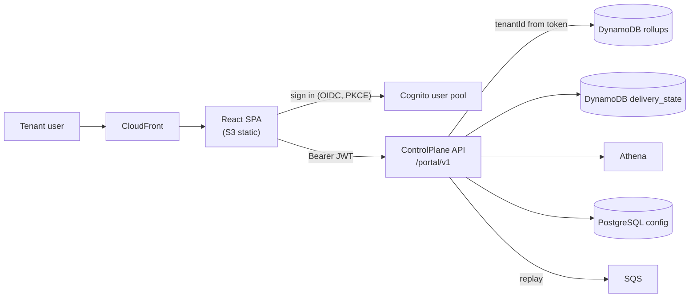

# Customer portal (UI)

Status: **PROPOSAL v1, for owner review** (2026-10-20). Repo: `webhookgateway-portal` (to be created; decision #12). API contract: OpenAPI, published from this repo.

## 1. Purpose

Tenants log in to see what is happening with their webhooks without asking support: how many events were accepted and delivered, what failed and why, which of their endpoints is slow, how big the backlog is, and how much of their plan they have used. Tenants can also fix things: replay failures, rotate keys, pause an endpoint, lower an endpoint's delivery rate.

## 2. Screens (v1)

| Screen | What the tenant sees | Data source |
|---|---|---|
| **Overview** | Accepted / delivered / failed over a selectable range (1 h, 24 h, 7 d, 30 d), success rate, accepted events per second now, backlog and oldest pending age, plan usage (events this month vs quota, rate-limit hits) | Rollups |
| **Endpoints** | Table of endpoints with health (`Healthy`, `Slow`, `Degraded`, `Paused`), success rate, p50/p95/p99 response time, timeout rate, pending / retrying / parked, **queue wait vs endpoint response time**, trend sparkline | Rollups |
| **Endpoint detail** | Time series per endpoint, recent failures, rate limit setting, pause/resume, rotate signing secret, test delivery button | Rollups + `delivery_state` |
| **Failures** | Filterable list (endpoint, status code, event type, time), attempt history with status code, latency, error text; payload view; single and bulk **replay** | `delivery_state` |
| **Event lookup** | Search by `eventId` or `deliveryId`: all deliveries and attempts. Recent failures instantly; older/successful events through Athena (seconds) | `delivery_state` + Athena |
| **Subscriptions** | Endpoints, event types, enable/disable | ControlPlane |
| **API keys** | Create, revoke, last used | ControlPlane |
| **Usage and limits** | Plan, accept rate, delivery rate, monthly usage, history | Rollups + `usage_monthly` |
| **Alerts** | Email (later webhook/Slack) when an endpoint fails above a threshold, is parked, or usage reaches 80% / 100% | ControlPlane |
| **Team** | Invite users, roles | ControlPlane + Cognito |

### Slow consumers (first-class in the UI)

"Slow consumer" is computed, not guessed. An endpoint is flagged `Slow` when its p95 response time exceeds a threshold (default 2 s) or its timeout rate exceeds 2% for 5 minutes, and `Degraded` when it fails above a threshold or its circuit is open.

- **Overview has a "Slow consumers" card**: endpoints ranked by *impact*, i.e. connection-seconds consumed (sum of response times) and share of the tenant's connection budget. Each row shows p95 now vs its normal baseline, timeout rate, pending count and an estimated drain time.
- **Connections gauge**: "connections in use / tenant limit" live (for example 640 / 1,000), with the top endpoints using them. When the tenant is at its limit, a banner says deliveries are being slowed by the connection cap and names the slow endpoints responsible.
- **Endpoints table** has a sortable Health column, response-time sparkline and a filter "Slow only".
- **Where the delay is**: every endpoint shows queue wait (our side) next to endpoint response time (their side), so tenants can tell "your server is slow" from "you are over your plan".
- **Actions**: lower the endpoint's delivery rate or connection limit, pause it (deliveries park instead of failing), or send a test delivery.
- **Alerts** (email at first): endpoint becomes `Slow` or `Degraded`, tenant uses more than 80% of its connection budget for 10 minutes.

## 3. Architecture



- **Stack:** React + TypeScript (Vite), a typed client generated from the OpenAPI spec, a charting library, hosted on S3 + CloudFront. **[DECIDE]** framework preference if you have one.
- **Login:** Amazon Cognito user pool, hosted UI with email + password and MFA; SSO (SAML/OIDC) for Enterprise later. The JWT carries `tenant_id` and `role`.
- **Tenant isolation:** the API derives `tenantId` from the validated token and never from request parameters; every query is keyed by it. Athena queries are built server-side with the tenant id fixed.
- **Refresh:** polling every 15 to 30 s in v1; server-sent events later for live tiles.
- **Security:** strict CSP, no tokens in local storage (in-memory + refresh cookie flow), payload viewer can mask configured JSON fields.
- **Roles:** `owner` (all), `developer` (everything except billing/team), `viewer` (read only; payloads masked by default).

## 4. ControlPlane portal API (sketch)

```
GET  /portal/v1/overview?range=24h
GET  /portal/v1/endpoints                      GET /portal/v1/endpoints/{id}/metrics?range=&resolution=
PATCH /portal/v1/endpoints/{id}                (pause, rate limit)
GET  /portal/v1/failures?endpointId=&status=&from=&to=&cursor=
POST /portal/v1/deliveries/{id}/replay         POST /portal/v1/deliveries/replay  (bulk, filter body)
GET  /portal/v1/events/{eventId}
GET  /portal/v1/usage
```
Cursor pagination everywhere; bulk replay is rate-limited per tenant and runs as a background job with progress.

## 5. Delivery plan

1. Overview + Endpoints + Failures with replay (the core value), after the Aggregator and `delivery_state` exist.
2. Event lookup, API keys, usage, subscriptions.
3. Alerts, team, SSO.

The portal is not on the event path: an outage of the portal or ControlPlane never affects ingest or delivery.
