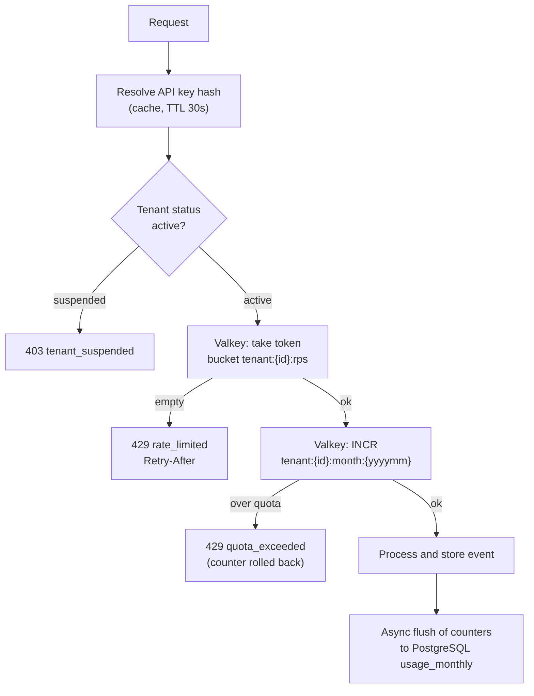

# Tenancy, plans and limits

Status: **PROPOSAL v1, for owner review** (2026-10-20). Companion to `architecture.md` v2. Nothing here changes `contracts.md` or `database.md` until approved.

## 1. Plans

| | Basic | Advanced | Premium |
|---|---|---|---|
| Events per second (sustained) | 100 | 500 | 1,000 |
| Burst capacity (2 seconds of rate) | 200 | 1,000 | 2,000 |
| Events per month | **TBD** (placeholder 1M) | **TBD** (placeholder 20M) | **TBD** (placeholder 100M) |
| Max endpoints | 10 | 50 | 200 |
| Max subscriptions per endpoint | 20 | 100 | unlimited |
| Max payload size | 256 KB | 256 KB | 256 KB |
| Event retention | 30 days | 30 days | 90 days |
| Delivery queue tier | basic | advanced | premium |

Only the per-second numbers come from the owner. Everything else is a placeholder to confirm. Limits are **data** in the `plans` table, so changing a number never needs a deploy.

A tenant can have **overrides** (a negotiated customer): any field above can be overridden per tenant.

## 2. What counts

- **Counts against rate and monthly quota:** one accepted `POST /v1/events` (a batch of N counts as N).
- **Does not count against the monthly quota:** duplicates (same idempotency key), requests rejected for validation or rate limiting.
- **Fan-out deliveries do not count** (decision #8 in architecture). The cost of fan-out is capped by the endpoint limit per plan instead.
- Month = UTC calendar month. **[DECIDE]** per-tenant billing cycle instead, if billing is not calendar-based.

## 3. Enforcement



**Token bucket** (per tenant): capacity = burst, refill = plan rate per second, executed as one atomic Lua script so all Ingest tasks share one truth.

**Monthly counter:** Valkey `INCRBY` with the key expiring 40 days after month end. A background job flushes to `usage_monthly` each minute and at shutdown. On cache loss the counter is reseeded from `usage_monthly` (under-counts at most one minute).

**Degraded mode:** if Valkey is unreachable, Ingest uses a local limiter at `plan rate / running tasks`, keeps accepting traffic, and alarms. Quota is checked against the last flushed PostgreSQL value plus the local count.

### Proposed response shape (contract change, pending approval)

```
HTTP 429 Too Many Requests
Retry-After: 1
RateLimit-Limit: 100
RateLimit-Remaining: 0
RateLimit-Reset: 1

{ "error": { "code": "rate_limited", "message": "Plan limit of 100 events/second exceeded." } }
```

`code` is one of `rate_limited`, `quota_exceeded`, `tenant_suspended`. For `quota_exceeded`, `Retry-After` is seconds until the next month starts.

## 4. Tenant configuration model

Held in PostgreSQL, changed only through the control-plane API, cached in memory (30s TTL, explicit invalidation).

| Table | Purpose |
|---|---|
| `plans` | code (`basic`, `advanced`, `premium`), rate, burst, monthly quota, max endpoints, retention, queue tier |
| `tenants` | id, name, status (`active`, `suspended`, `closed`), `plan_code`, **`home_region`** (default `ap-south-1`), created_at |
| `tenant_overrides` | tenant_id, field, value: per-tenant exceptions to plan limits |
| `api_keys` | tenant_id, key hash, prefix, revoked_at, last_used_at |
| `endpoints` | existing; adds `encrypted_signing_secret` and key id (KMS envelope) if decision #4 is approved |
| `subscriptions` | existing |
| `usage_monthly` | tenant_id, month, accepted_events, rejected_rate, rejected_quota, updated_at |

Effective limit = override if present, else plan value. The control plane validates plan changes (a downgrade below current endpoint count is refused with a clear error).

Lifecycle: tenants are created by an operator (no self-service signup in v1); `suspended` stops ingest immediately (cache invalidation) and pauses deliveries; `closed` follows the retention policy and then deletes data.

## 5. Observability and fairness signals

- Per-tenant metrics (low-cardinality by plan tier in CloudWatch; full per-tenant detail in logs/traces): accepted, rate-limited, quota-rejected, delivery success rate, queue age.
- Alerts: tenant at 80% and 100% of monthly quota (also an email to the tenant, **[DECIDE]** later), Valkey degraded mode, queue age over target per tier.

## 6. Scale triggers (when to build the next step)

| Signal | Threshold (proposed) | Action |
|---|---|---|
| Aurora writer CPU, sustained 15 min | over 60% | Scale up; plan ingest buffer |
| Ingest p95 DB commit latency | over 50 ms for 15 min | Build ingest buffer (SQS/Kinesis + batch fan-out) |
| Platform-wide accepted events/s | over 1,500 sustained | Review capacity with owner |
| Premium queue age | over 30 s | Add Dispatcher capacity, check noisy endpoints |
| Customers needing India DR or another geography | first request | Start cell #2 work (architecture section 9) |

## 7. Open questions

1. Monthly caps for all three plans (placeholders above).
2. Do the max-endpoint and retention numbers match your pricing plan?
3. Calendar month or billing-cycle month?
4. Hard stop at quota, or allow paid overage on Advanced/Premium?
5. Should tenants get a self-service usage endpoint (`GET /v1/usage`) in v1?
