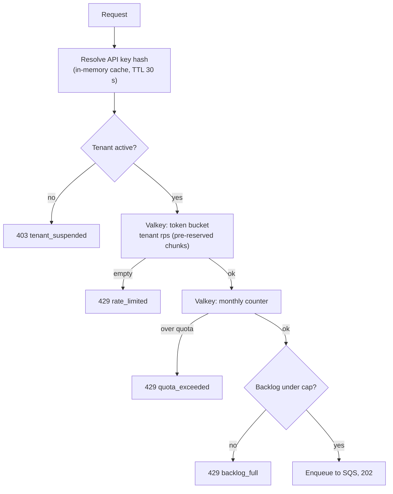

# Tenancy, plans and limits

Status: **PROPOSAL v2, for owner review** (2026-10-20). Companion to `architecture.md` v3. Nothing here changes `contracts.md` or `database.md` until approved.

## 1. Plans

| | Basic | Advanced | Premium | Enterprise |
|---|---|---|---|---|
| **Accept** rate (events/s, sustained) | 100 | 500 | 1,000 | custom |
| Burst capacity (2 s of rate) | 200 | 1,000 | 2,000 | custom |
| Events per month | **TBD** (placeholder 1M) | **TBD** (20M) | **TBD** (100M) | custom |
| **Delivery** rate (deliveries/s, steady) | 300 | 1,500 | 3,000 | custom |
| **Max concurrent connections** (all endpoints of the tenant) | 200 | 1,000 | 3,000 | custom |
| Max concurrent connections per endpoint (default, tenant can lower) | 20 | 50 | 100 | custom |
| Max backlog (pending deliveries) | 500k | 5M | 20M | custom |
| Max backlog age | 24 h | 24 h | 24 h | custom |
| Max endpoints | 10 | 50 | 200 | custom |
| Per-endpoint delivery rate (default, tenant can lower) | 50/s | 200/s | 500/s | custom |
| Max payload size | 256 KB | 256 KB | 256 KB | 256 KB |
| Event history retention (archive, failures, rollups) | 30 d | 30 d | 90 d | custom |
| Idempotency window | 1 h | 24 h | 24 h | custom |
| Delivery queue tier | basic | advanced | premium | premium or dedicated |

Only the accept rates (100 / 500 / 1,000) come from the owner. Everything else is a placeholder to confirm. All limits are **data** in the `plans` table, so changing a number needs no deploy. Per-tenant **overrides** replace any field for one tenant. The delivery-rate placeholder is 3 times the accept rate, assuming an average fan-out of 3; a tenant with a higher fan-out needs a higher delivery rate or it builds a backlog.

A 30,000 events/s cell holds many tenants: for example 10 Premium (10k) + 20 Advanced (10k) + 100 Basic (10k).

## 2. Two limits: accept and deliver

| | Accept | Deliver |
|---|---|---|
| Where | Ingest | Fan-out (slot assignment), then Dispatcher |
| Unit | events/s, events/month | deliveries/s (per tenant and per endpoint), backlog size |
| Bursts | Allowed up to the plan's burst capacity | Absorbed into the backlog and paced out |
| Over the limit | `429 rate_limited` or `quota_exceeded` | No error: the delivery waits; `429 backlog_full` at Ingest only when the backlog cap is hit |

This is the "accept on the fly, publish steadily" rule: the producer is never slowed below its plan, and the consumer is never hit above its configured rate.

## 3. What counts

- **Counts against accept rate and monthly quota:** one accepted `POST /v1/events` (a batch of N counts as N).
- **Does not count against monthly quota:** duplicates (same idempotency key within the window), and requests rejected for validation, rate, quota or backlog.
- **Fan-out deliveries do not count** against the accept limits; they are bounded by the delivery rate, the backlog cap and the endpoint cap.
- Month = UTC calendar month. **[DECIDE]** per-tenant billing cycle instead.

## 4. Accept enforcement (Ingest)



- **Token bucket** per tenant, atomic Lua script, capacity = burst, refill = plan rate. Ingest tasks reserve tokens in chunks (about 20) to cut Valkey calls at high volume.
- **Monthly counter:** Valkey `INCRBY`, key expiring 40 days after month end, flushed to PostgreSQL `usage_monthly` once a minute and at shutdown. After a cache loss it is reseeded from PostgreSQL (under-counts at most one minute, never over-counts).
- **Backlog gauge:** pending deliveries per tenant = created minus completed, kept in Valkey from fan-out and Dispatcher counters (approximate, reconciled by the Aggregator).
- **Degraded mode:** if Valkey is unreachable, Ingest uses a local limiter at `plan rate / running tasks`, keeps accepting, and alarms.

Proposed `429` response (contract change, pending approval):

```
HTTP 429 Too Many Requests
Retry-After: 1
RateLimit-Limit: 100
RateLimit-Remaining: 0
RateLimit-Reset: 1

{ "error": { "code": "rate_limited", "message": "Plan limit of 100 events/second exceeded." } }
```

`code` is one of `rate_limited`, `quota_exceeded`, `backlog_full`, `tenant_suspended`. For `quota_exceeded`, `Retry-After` is seconds until next month.

## 5. Delivery pacing and connection limits

See `architecture.md` section 5.1 for pacing and section 5 for slow-consumer isolation. Parameters per tenant: delivery rate (plan or override), per-endpoint rate (default from plan; tenant can lower it in the portal, never raise it above the plan), **max concurrent connections** for the tenant and per endpoint, backlog caps.

Why the connection cap matters: connections in use = deliveries/s x response time. Examples with the Basic limit of 200 connections:

| Endpoint response time | Deliveries/s the tenant can sustain with 200 connections |
|---|---|
| 100 ms | 2,000 (the 300/s delivery rate binds first) |
| 1 s | 200 |
| 10 s (near timeout) | 20 |

So a slow consumer throttles itself and its own tenant, not other tenants. The portal shows connection usage live and tells the tenant which endpoint is using the budget.

How it is enforced (Dispatcher): permit leases in Valkey (`conn:{tenant}` and `conn:{tenant}:{endpoint}`, short lease renewed while in use); no permit means the message is re-queued with a short delay and the worker takes other work; plus a per-task fair share across tenants as the fallback if Valkey is unavailable.

## 6. Tenant configuration model (PostgreSQL, config only)

Changed only through the ControlPlane API; read through an in-memory cache (30 s TTL, explicit invalidation on change).

| Table | Purpose |
|---|---|
| `plans` | code, accept rate, burst, monthly quota, delivery rate, backlog caps, endpoint cap, per-endpoint rate, retention, idempotency window, queue tier |
| `tenants` | id, name, status (`active`, `suspended`, `closed`), `plan_code`, **`home_region`** (default `ap-south-1`), created_at |
| `tenant_overrides` | tenant_id, field, value |
| `api_keys` | tenant_id, key hash, prefix, revoked_at, last_used_at |
| `users` / `tenant_members` | portal users mapped to a tenant and role (`owner`, `developer`, `viewer`); identity itself lives in Cognito |
| `endpoints` | id, tenant_id, url, status, auth mode, **delivery rate limit**, encrypted signing secret + KMS key id (decision #7) |
| `subscriptions` | tenant_id, endpoint_id, event type (`*` allowed) |
| `usage_monthly` | tenant_id, month, accepted, rejected_rate, rejected_quota, rejected_backlog |

Effective limit = override if present, else plan value. A downgrade below the current endpoint count is refused with a clear error. Tenants are created by an operator in v1 (no self-service signup); `suspended` stops ingest and pauses deliveries; `closed` follows retention and then deletes data.

The high-volume data (events, deliveries, results, rollups) is **not** in PostgreSQL: see `data-plane.md`.

## 7. Open questions

1. Monthly caps for all plans (placeholders above); is there an Enterprise plan at launch?
2. Do the delivery rate, backlog, endpoint and retention numbers match your pricing?
3. Calendar month or billing-cycle month?
4. Hard stop at quota, or billable overage on Advanced/Premium?
5. Should tenants get `GET /v1/usage` (API) in v1, in addition to the portal?
6. What should happen at `backlog_full`: reject new events (proposed) or accept and drop the oldest?
